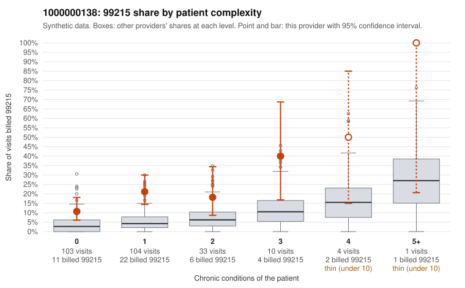

# 1000000138: 1000000138: too few returned records to judge

**Leaning (advisory):** Inconclusive

## Why

1000000138 billed 99215 on 18.0% of 255 claims against an expected 4.5% given patient complexity (risk-adjusted score 3.47; plain z-score vs peers 1.49). 72% of this provider's 99215 claims were on patients with 0 or 1 chronic conditions. Records came back for 45 claims. Of 17 documented 99215 claims, 6 (35%) were documented below the billed level, against 32% for the comparison providers. Note checks on 45 returned notes (share showing each sign): problems 38%, late 9%, unsigned 0%, data 2%, bulk created 0%, paste heavy 0%. 1 of 31 notes claiming moderate-or-higher data reviewed had no lab or test line on the claim. The evidence does not support a call either way yet. Examples: C0060952: billed 99215, patient aged 65 with 0 chronic condition(s); documented MDM level moderate, minutes not recorded. C0060955: billed 99215, patient aged 67 with 0 chronic condition(s); documented MDM level moderate, minutes not recorded. C0060919: billed 99215, patient aged 58 with 0 chronic condition(s). C0060941: billed 99215, patient aged 36 with 0 chronic condition(s); documented MDM level high, 42 minutes.

## Evidence chart

## Cited claims

`C0060952`, `C0060955`, `C0060919`, `C0060941`

## Suggested next steps

- 45 charts came back but do not settle it: request a targeted sample of 99215 charts, starting with C0060952, C0060955, C0060919.
- Re-check after the targeted charts arrive; do not call upcoding or a sicker panel on this evidence alone.

---
Citations checked: 4/4 valid. Synthetic data. The leaning is advisory; the flag comes from the statistical screen, and no clinical documentation is available beyond the sampled records-review facts shown in the packet.
