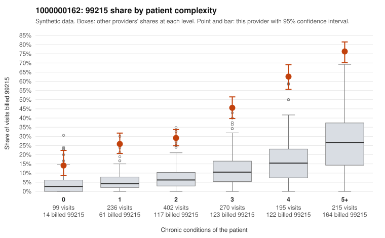

# 1000000162: 1000000162: too few returned records to judge

**Leaning (advisory):** Inconclusive

## Why

1000000162 billed 99215 on 42.4% of 1,417 claims against an expected 9.8% given patient complexity (risk-adjusted score 14.20; plain z-score vs peers 5.03). 12% of this provider's 99215 claims were on patients with 0 or 1 chronic conditions. Records came back for 30 claims. Of 14 documented 99215 claims, 2 (14%) were documented below the billed level, against 32% for the comparison providers. Note checks on 30 returned notes (share showing each sign): problems 20%, late 7%, unsigned 0%, data 0%. No audit trail was received. 0 of 21 notes claiming moderate-or-higher data reviewed had no lab or test line on the claim. The evidence does not support a call either way yet. Examples: C0069908: billed 99215; documented MDM level moderate, minutes not recorded. C0071112: billed 99215; documented MDM level moderate, minutes not recorded. C0069864: billed 99215, patient aged 25 with 0 chronic condition(s). C0069932: billed 99215, patient aged 56 with 1 chronic condition(s) (type 2 diabetes).

## Evidence chart

## Cited claims

`C0069908`, `C0071112`, `C0069864`, `C0069932`

## Suggested next steps

- 30 charts came back but do not settle it: request a targeted sample of 99215 charts, starting with C0069908, C0071112, C0069864.
- Re-check after the targeted charts arrive; do not call upcoding or a sicker panel on this evidence alone.

---
Citations checked: 4/4 valid. Synthetic data. The leaning is advisory; the flag comes from the statistical screen, and no clinical documentation is available beyond the sampled records-review facts shown in the packet.
