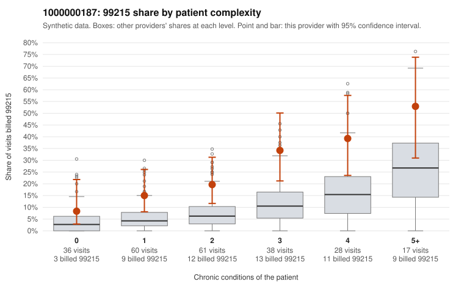

# 1000000187: 1000000187: 7 of 9 documented 99215 claims (78%) are documented below the billed level

**Leaning (advisory):** Pattern consistent with upcoding

## Why

1000000187 billed 99215 on 23.8% of 240 claims against an expected 7.8% given patient complexity (risk-adjusted score 3.12; plain z-score vs peers 2.32). 21% of this provider's 99215 claims were on patients with 0 or 1 chronic conditions. Records came back for 29 claims. Of 9 documented 99215 claims, 7 (78%) were documented below the billed level, against 32% for the comparison providers. Note checks on 29 returned notes (share showing each sign): problems 14%, late 3%, unsigned 0%, data 3%. No audit trail was received. 1 of 16 notes claiming moderate-or-higher data reviewed had no lab or test line on the claim. This pattern is consistent with upcoding. It is a reason to review the records, not a finding. Examples: C0079320: billed 99215; documented MDM level moderate, 20 minutes. C0079321: billed 99215, patient aged 66 with 4 chronic condition(s) (type 2 diabetes;hyperlipidemia;depression;chronic kidney disease); documented MDM level moderate, 24 minutes. C0079412: billed 99215; documented MDM level moderate, 33 minutes. C0079255: billed 99215, patient aged 28 with 1 chronic condition(s) (atrial fibrillation). C0079271: billed 99215, patient aged 47 with 1 chronic condition(s) (hypertension). C0079295: billed 99215, patient aged 50 with 1 chronic condition(s) (hypertension).

## Evidence chart

## Cited claims

`C0079320`, `C0079321`, `C0079412`, `C0079255`, `C0079271`, `C0079295`

## Suggested next steps

- Request the full charts for C0079320, C0079321, C0079412 and have a certified coder re-score each against the current E/M rules (medical decision making or total time).
- If the re-scoring confirms the pattern, review the random sample in the recovery packet's sampling plan before any overpayment estimate; do not extrapolate from a targeted sample.
- Look at the notes themselves: 14% address fewer problems than their level implies and 3% were signed late; request the audit trail for C0079320, C0079321, C0079412.

---
Citations checked: 6/6 valid. Synthetic data. The leaning is advisory; the flag comes from the statistical screen, and no clinical documentation is available beyond the sampled records-review facts shown in the packet.
