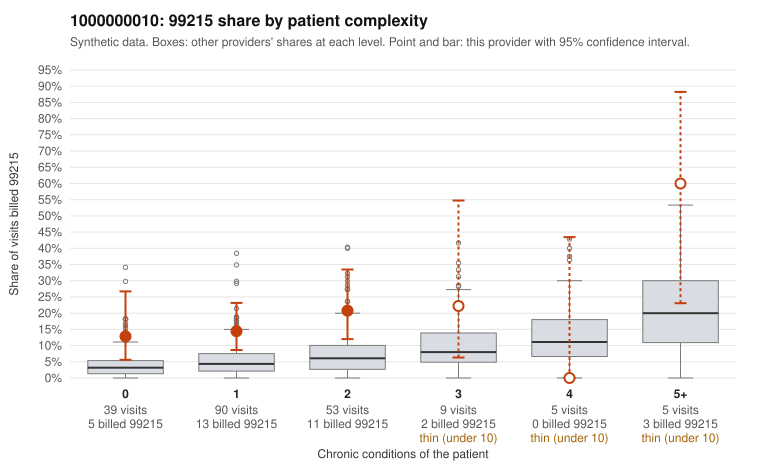

# 1000000010: 1000000010: too few returned records to judge

**Leaning (advisory):** Inconclusive

## Why

1000000010 billed 99215 on 16.9% of 201 claims against an expected 4.8% given patient complexity (risk-adjusted score 2.86; plain z-score vs peers 1.60). 53% of this provider's 99215 claims were on patients with 0 or 1 chronic conditions. Records came back for 30 claims. Of 6 documented 99215 claims, 1 (17%) were documented below the billed level, against 46% for the comparison providers. Note checks on 30 returned notes (share showing each sign): problems 43%, late 3%, unsigned 0%, data 3%, bulk created 0%, paste heavy 0%. 3 of 22 notes claiming moderate-or-higher data reviewed had no lab or test line on the claim. The evidence does not support a call either way yet. Examples: C0002497: billed 99215, patient aged 67 with 1 chronic condition(s) (hypertension); documented MDM level moderate, 34 minutes. C0002489: billed 99215, patient aged 57 with 1 chronic condition(s) (type 2 diabetes).

## Evidence chart

## Cited claims

`C0002497`, `C0002489`

## Suggested next steps

- 30 charts came back but do not settle it: request a targeted sample of 99215 charts, starting with C0002497, C0002489.
- Re-check after the targeted charts arrive; do not call upcoding or a sicker panel on this evidence alone.

---
Citations checked: 2/2 valid. Synthetic data. The leaning is advisory; the flag comes from the statistical screen, and no clinical documentation is available beyond the sampled records-review facts shown in the packet.
