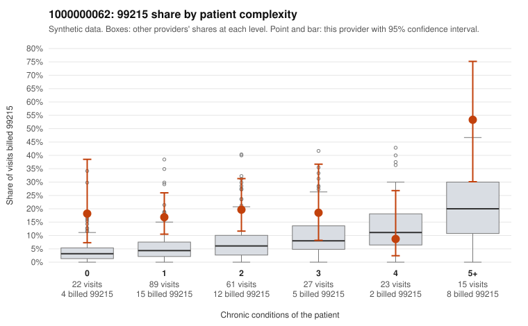

# 1000000062: 1000000062: 1 of 20 documented 99215 claims (5%) are documented below the billed level

**Leaning (advisory):** Pattern consistent with upcoding

## Why

1000000062 billed 99215 on 19.4% of 237 claims against an expected 6.0% given patient complexity (risk-adjusted score 3.11; plain z-score vs peers 2.02). 41% of this provider's 99215 claims were on patients with 0 or 1 chronic conditions. Records came back for 45 claims. Of 20 documented 99215 claims, 1 (5%) were documented below the billed level, against 46% for the comparison providers. Note checks on 45 returned notes (share showing each sign): problems 29%, late 27%, unsigned 0%, data 11%, bulk created 4%, paste heavy 7%. 6 of 36 notes claiming moderate-or-higher data reviewed had no lab or test line on the claim. This pattern is consistent with upcoding. It is a reason to review the records, not a finding. Examples: C0026448: billed 99215, patient aged 47 with 5 chronic condition(s) (type 2 diabetes;obesity;hypertension;atrial fibrillation;asthma); documented MDM level moderate, 36 minutes. C0026265: billed 99215, patient aged 50 with 1 chronic condition(s) (heart failure). C0026325: billed 99215, patient aged 28 with 0 chronic condition(s); documented MDM level high, minutes not recorded. C0026342: billed 99215, patient aged 45 with 1 chronic condition(s) (obesity).

## Evidence chart

## Cited claims

`C0026448`, `C0026265`, `C0026325`, `C0026342`

## Suggested next steps

- Request the full charts for C0026448, C0026265, C0026325 and have a certified coder re-score each against the current E/M rules (medical decision making or total time).
- If the re-scoring confirms the pattern, review the random sample in the recovery packet's sampling plan before any overpayment estimate; do not extrapolate from a targeted sample.
- Look at the notes themselves: 29% address fewer problems than their level implies and 27% were signed late; request the audit trail for C0026448, C0026265, C0026325.

---
Citations checked: 4/4 valid. Synthetic data. The leaning is advisory; the flag comes from the statistical screen, and no clinical documentation is available beyond the sampled records-review facts shown in the packet.
