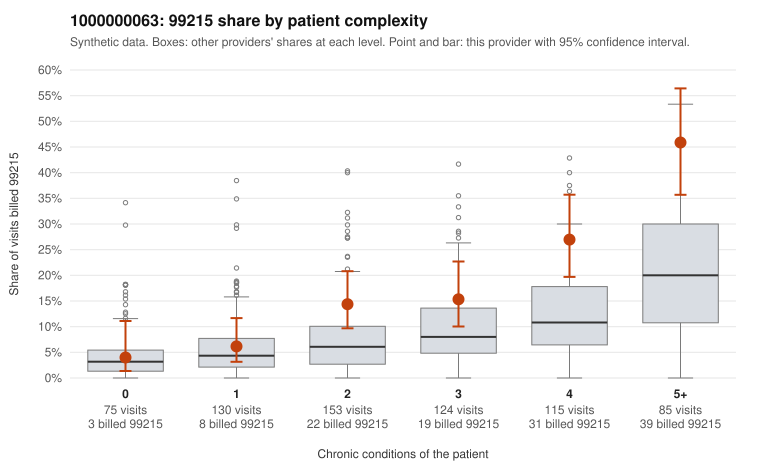

# 1000000063: 1000000063: too few returned records to judge

**Leaning (advisory):** Inconclusive

## Why

1000000063 billed 99215 on 17.9% of 682 claims against an expected 7.3% given patient complexity (risk-adjusted score 3.84; plain z-score vs peers 1.77). 9% of this provider's 99215 claims were on patients with 0 or 1 chronic conditions. Records came back for 30 claims. Of 5 documented 99215 claims, 1 (20%) were documented below the billed level, against 46% for the comparison providers. Note checks on 30 returned notes (share showing each sign): problems 13%, late 10%, unsigned 0%, data 3%. No audit trail was received. 1 of 24 notes claiming moderate-or-higher data reviewed had no lab or test line on the claim. The evidence does not support a call either way yet. Examples: C0026638: billed 99215, patient aged 44 with 4 chronic condition(s) (hypertension;heart failure;COPD;chronic kidney disease); documented MDM level moderate, minutes not recorded. C0026558: billed 99215, patient aged 34 with 1 chronic condition(s) (asthma). C0026562: billed 99215, patient aged 68 with 1 chronic condition(s) (depression).

## Evidence chart

## Cited claims

`C0026638`, `C0026558`, `C0026562`

## Suggested next steps

- 30 charts came back but do not settle it: request a targeted sample of 99215 charts, starting with C0026638, C0026558, C0026562.
- Re-check after the targeted charts arrive; do not call upcoding or a sicker panel on this evidence alone.

---
Citations checked: 3/3 valid. Synthetic data. The leaning is advisory; the flag comes from the statistical screen, and no clinical documentation is available beyond the sampled records-review facts shown in the packet.
