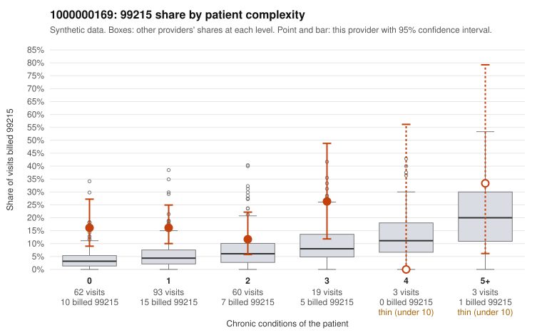

# 1000000169: 1000000169: too few returned records to judge

**Leaning (advisory):** Inconclusive

## Why

1000000169 billed 99215 on 15.8% of 240 claims against an expected 4.6% given patient complexity (risk-adjusted score 2.96; plain z-score vs peers 1.42). 66% of this provider's 99215 claims were on patients with 0 or 1 chronic conditions. Records came back for 45 claims. Of 17 documented 99215 claims, 1 (6%) were documented below the billed level, against 46% for the comparison providers. Note checks on 45 returned notes (share showing each sign): problems 44%, late 11%, unsigned 0%, data 9%, bulk created 4%, paste heavy 4%. 6 of 34 notes claiming moderate-or-higher data reviewed had no lab or test line on the claim. The evidence does not support a call either way yet. Examples: C0072512: billed 99215, patient aged 45 with 1 chronic condition(s) (atrial fibrillation); documented MDM level moderate, minutes not recorded. C0072401: billed 99215, patient aged 79 with 1 chronic condition(s) (obesity). C0072404: billed 99215, patient aged 49 with 0 chronic condition(s).

## Evidence chart

## Cited claims

`C0072512`, `C0072401`, `C0072404`

## Suggested next steps

- 45 charts came back but do not settle it: request a targeted sample of 99215 charts, starting with C0072512, C0072401, C0072404.
- Re-check after the targeted charts arrive; do not call upcoding or a sicker panel on this evidence alone.

---
Citations checked: 3/3 valid. Synthetic data. The leaning is advisory; the flag comes from the statistical screen, and no clinical documentation is available beyond the sampled records-review facts shown in the packet.
