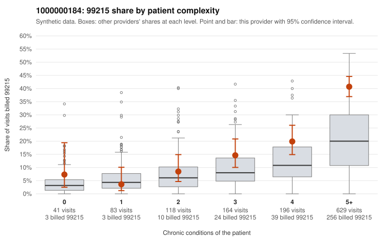

# 1000000184: 1000000184: documented 99215 claims mostly support the level billed (0% below)

**Leaning (advisory):** Pattern consistent with a high-acuity panel

## Why

1000000184 billed 99215 on 27.2% of 1,231 claims against an expected 11.5% given patient complexity (risk-adjusted score 6.36; plain z-score vs peers 3.33). 2% of this provider's 99215 claims were on patients with 0 or 1 chronic conditions. Records came back for 30 claims. Of 6 documented 99215 claims, 0 (0%) were documented below the billed level, against 46% for the comparison providers. Note checks on 30 returned notes (share showing each sign): problems 7%, late 7%, unsigned 0%, data 10%. No audit trail was received. 4 of 21 notes claiming moderate-or-higher data reviewed had no lab or test line on the claim. This pattern is consistent with a high-acuity panel. The sampled documentation supports the billed level. Examples: C0081227: billed 99215; documented MDM level high, 46 minutes. C0081513: billed 99215; documented MDM level high, minutes not recorded. C0081522: billed 99215; documented MDM level high, 36 minutes. C0081205: billed 99215, patient aged 71 with 5 chronic condition(s) (type 2 diabetes;obesity;hyperlipidemia;hypertension;atrial fibrillation). C0081385: billed 99215, patient aged 62 with 5 chronic condition(s) (hypothyroidism;type 2 diabetes;depression;COPD;asthma).

## Evidence chart

## Cited claims

`C0081227`, `C0081513`, `C0081522`, `C0081205`, `C0081385`

## Suggested next steps

- Do not pursue recovery on this evidence: 30 charts came back and they support the level billed (0 of 6 documented 99215 claims below the billed level).
- Revisit if the 99215 share keeps rising against peers or a larger sample shows unsupported claims.

---
Citations checked: 5/5 valid. Synthetic data. The leaning is advisory; the flag comes from the statistical screen, and no clinical documentation is available beyond the sampled records-review facts shown in the packet.
