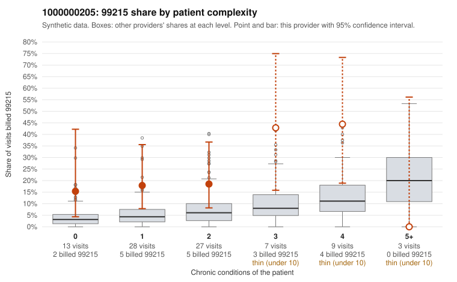

# 1000000205: 1000000205: too few returned records to judge

**Leaning (advisory):** Inconclusive

## Why

1000000205 billed 99215 on 21.8% of 87 claims against an expected 5.6% given patient complexity (risk-adjusted score 2.32; plain z-score vs peers 2.43). 37% of this provider's 99215 claims were on patients with 0 or 1 chronic conditions. Records came back for 30 claims. Of 4 documented 99215 claims, 3 (75%) were documented below the billed level, against 46% for the comparison providers. Note checks on 30 returned notes (share showing each sign): problems 13%, late 3%, unsigned 0%, data 7%. No audit trail was received. 4 of 23 notes claiming moderate-or-higher data reviewed had no lab or test line on the claim. The evidence does not support a call either way yet. Examples: C0092485: billed 99215, patient aged 56 with 0 chronic condition(s); documented MDM level moderate, minutes not recorded. C0092538: billed 99215; documented MDM level moderate, minutes not recorded. C0092465: billed 99215, patient aged 45 with 1 chronic condition(s) (type 2 diabetes). C0092467: billed 99215, patient aged 39 with 1 chronic condition(s) (hyperlipidemia).

## Evidence chart

## Cited claims

`C0092485`, `C0092538`, `C0092465`, `C0092467`

## Suggested next steps

- 30 charts came back but do not settle it: request a targeted sample of 99215 charts, starting with C0092485, C0092538, C0092465.
- Re-check after the targeted charts arrive; do not call upcoding or a sicker panel on this evidence alone.

---
Citations checked: 4/4 valid. Synthetic data. The leaning is advisory; the flag comes from the statistical screen, and no clinical documentation is available beyond the sampled records-review facts shown in the packet.
