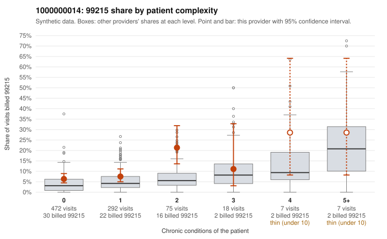

# 1000000014: 1000000014: too few returned records to judge

**Leaning (advisory):** Inconclusive

## Why

1000000014 billed 99215 on 8.5% of 871 claims against an expected 3.7% given patient complexity (risk-adjusted score 2.71; plain z-score vs peers 0.21). 70% of this provider's 99215 claims were on patients with 0 or 1 chronic conditions. Records came back for 30 claims. Of 1 documented 99215 claims, 0 (0%) were documented below the billed level, against 29% for the comparison providers. Note checks on 30 returned notes (share showing each sign): problems 33%, late 3%, unsigned 0%, data 0%. No audit trail was received. 0 of 14 notes claiming moderate-or-higher data reviewed had no lab or test line on the claim. The evidence does not support a call either way yet. Examples: C0011414: billed 99215, patient aged 59 with 0 chronic condition(s). C0011415: billed 99215, patient aged 40 with 1 chronic condition(s) (atrial fibrillation).

## Evidence chart

## Cited claims

`C0011414`, `C0011415`

## Suggested next steps

- 30 charts came back but do not settle it: request a targeted sample of 99215 charts, starting with C0011414, C0011415.
- Re-check after the targeted charts arrive; do not call upcoding or a sicker panel on this evidence alone.

---
Citations checked: 2/2 valid. Synthetic data. The leaning is advisory; the flag comes from the statistical screen, and no clinical documentation is available beyond the sampled records-review facts shown in the packet.
