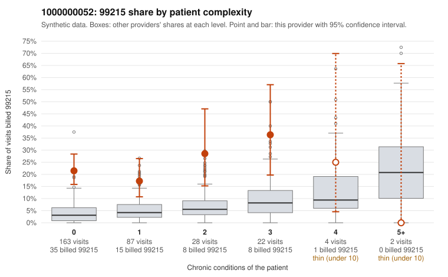

# 1000000052: 1000000052: 17 of 19 documented 99215 claims (90%) are documented below the billed level

**Leaning (advisory):** Pattern consistent with upcoding

## Why

1000000052 billed 99215 on 21.9% of 306 claims against an expected 3.9% given patient complexity (risk-adjusted score 6.07; plain z-score vs peers 2.53). 75% of this provider's 99215 claims were on patients with 0 or 1 chronic conditions. Records came back for 45 claims. Of 19 documented 99215 claims, 17 (90%) were documented below the billed level, against 29% for the comparison providers. Note checks on 45 returned notes (share showing each sign): problems 47%, late 7%, unsigned 0%, data 2%. No audit trail was received. 3 of 23 notes claiming moderate-or-higher data reviewed had no lab or test line on the claim. This pattern is consistent with upcoding. It is a reason to review the records, not a finding. Examples: C0029410: billed 99215, patient aged 55 with 0 chronic condition(s); documented MDM level moderate, 33 minutes. C0029431: billed 99215; documented MDM level moderate, minutes not recorded. C0029460: billed 99215; documented MDM level moderate, minutes not recorded. C0029166: billed 99215, patient aged 40 with 0 chronic condition(s). C0029174: billed 99215, patient aged 46 with 1 chronic condition(s) (obesity). C0029176: billed 99215, patient aged 45 with 0 chronic condition(s).

## Evidence chart

## Cited claims

`C0029410`, `C0029431`, `C0029460`, `C0029166`, `C0029174`, `C0029176`

## Suggested next steps

- Request the full charts for C0029410, C0029431, C0029460 and have a certified coder re-score each against the current E/M rules (medical decision making or total time).
- If the re-scoring confirms the pattern, review the random sample in the recovery packet's sampling plan before any overpayment estimate; do not extrapolate from a targeted sample.
- Look at the notes themselves: 47% address fewer problems than their level implies and 7% were signed late; request the audit trail for C0029410, C0029431, C0029460.

---
Citations checked: 6/6 valid. Synthetic data. The leaning is advisory; the flag comes from the statistical screen, and no clinical documentation is available beyond the sampled records-review facts shown in the packet.
