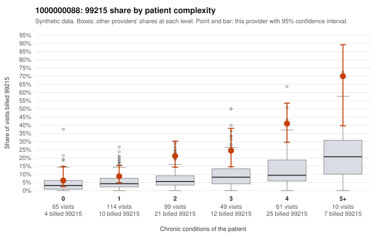

# 1000000088: 1000000088: too few returned records to judge

**Leaning (advisory):** Inconclusive

## Why

1000000088 billed 99215 on 19.8% of 398 claims against an expected 5.9% given patient complexity (risk-adjusted score 4.37; plain z-score vs peers 2.18). 18% of this provider's 99215 claims were on patients with 0 or 1 chronic conditions. Records came back for 30 claims. Of 7 documented 99215 claims, 2 (29%) were documented below the billed level, against 29% for the comparison providers. Note checks on 30 returned notes (share showing each sign): problems 13%, late 10%, unsigned 0%, data 0%. No audit trail was received. 4 of 22 notes claiming moderate-or-higher data reviewed had no lab or test line on the claim. The evidence does not support a call either way yet. Examples: C0045298: billed 99215; documented MDM level moderate, 35 minutes. C0045465: billed 99215; documented MDM level moderate, 35 minutes. C0045153: billed 99215, patient aged 35 with 0 chronic condition(s). C0045159: billed 99215, patient aged 40 with 0 chronic condition(s); documented MDM level high, 47 minutes.

## Evidence chart

## Cited claims

`C0045298`, `C0045465`, `C0045153`, `C0045159`

## Suggested next steps

- 30 charts came back but do not settle it: request a targeted sample of 99215 charts, starting with C0045298, C0045465, C0045153.
- Re-check after the targeted charts arrive; do not call upcoding or a sicker panel on this evidence alone.

---
Citations checked: 4/4 valid. Synthetic data. The leaning is advisory; the flag comes from the statistical screen, and no clinical documentation is available beyond the sampled records-review facts shown in the packet.
