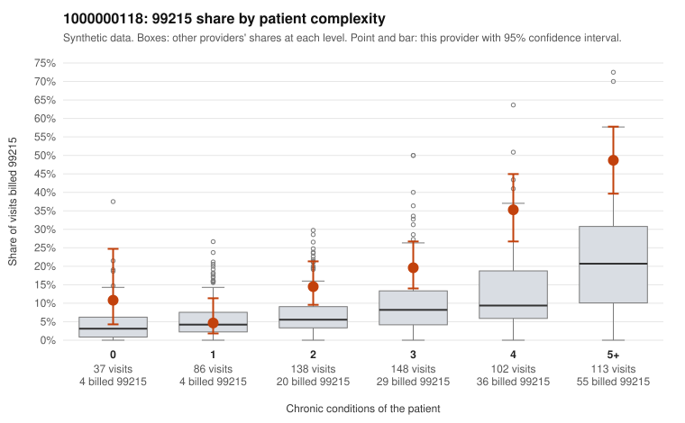

# 1000000118: 1000000118: documented 99215 claims mostly support the level billed (0% below)

**Leaning (advisory):** Pattern consistent with a high-acuity panel

## Why

1000000118 billed 99215 on 23.7% of 624 claims against an expected 9.2% given patient complexity (risk-adjusted score 4.74; plain z-score vs peers 2.85). 5% of this provider's 99215 claims were on patients with 0 or 1 chronic conditions. Records came back for 30 claims. Of 8 documented 99215 claims, 0 (0%) were documented below the billed level, against 29% for the comparison providers. Note checks on 30 returned notes (share showing each sign): problems 3%, late 3%, unsigned 0%, data 3%. No audit trail was received. 3 of 25 notes claiming moderate-or-higher data reviewed had no lab or test line on the claim. This pattern is consistent with a high-acuity panel. The sampled documentation supports the billed level. Examples: C0061692: billed 99215; documented MDM level high, 45 minutes. C0061699: billed 99215; documented MDM level high, 44 minutes. C0062001: billed 99215, patient aged 57 with 5 chronic condition(s) (obesity;depression;hypertension;heart failure;asthma); documented MDM level high, 52 minutes. C0061644: billed 99215, patient aged 78 with 5 chronic condition(s) (type 2 diabetes;obesity;hypertension;atrial fibrillation;COPD). C0061784: billed 99215, patient aged 51 with 4 chronic condition(s) (obesity;depression;hypertension;asthma).

## Evidence chart

## Cited claims

`C0061692`, `C0061699`, `C0062001`, `C0061644`, `C0061784`

## Suggested next steps

- Do not pursue recovery on this evidence: 30 charts came back and they support the level billed (0 of 8 documented 99215 claims below the billed level).
- Revisit if the 99215 share keeps rising against peers or a larger sample shows unsupported claims.

---
Citations checked: 5/5 valid. Synthetic data. The leaning is advisory; the flag comes from the statistical screen, and no clinical documentation is available beyond the sampled records-review facts shown in the packet.
