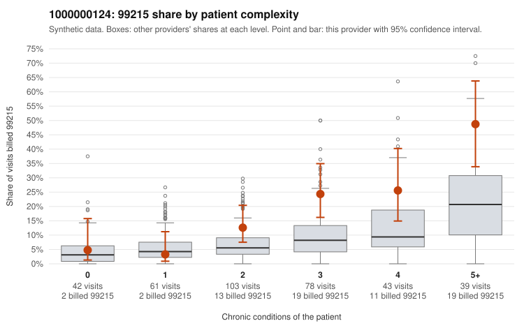

# 1000000124: 1000000124: too few returned records to judge

**Leaning (advisory):** Inconclusive

## Why

1000000124 billed 99215 on 18.0% of 366 claims against an expected 7.5% given patient complexity (risk-adjusted score 2.80; plain z-score vs peers 1.86). 6% of this provider's 99215 claims were on patients with 0 or 1 chronic conditions. Records came back for 30 claims. Of 9 documented 99215 claims, 3 (33%) were documented below the billed level, against 29% for the comparison providers. Note checks on 30 returned notes (share showing each sign): problems 10%, late 10%, unsigned 0%, data 0%. No audit trail was received. 1 of 21 notes claiming moderate-or-higher data reviewed had no lab or test line on the claim. The evidence does not support a call either way yet. Examples: C0063278: billed 99215; documented MDM level moderate, minutes not recorded. C0063454: billed 99215; documented MDM level moderate, 28 minutes. C0063217: billed 99215, patient aged 33 with 0 chronic condition(s). C0063390: billed 99215, patient aged 43 with 0 chronic condition(s).

## Evidence chart

## Cited claims

`C0063278`, `C0063454`, `C0063217`, `C0063390`

## Suggested next steps

- 30 charts came back but do not settle it: request a targeted sample of 99215 charts, starting with C0063278, C0063454, C0063217.
- Re-check after the targeted charts arrive; do not call upcoding or a sicker panel on this evidence alone.

---
Citations checked: 4/4 valid. Synthetic data. The leaning is advisory; the flag comes from the statistical screen, and no clinical documentation is available beyond the sampled records-review facts shown in the packet.
