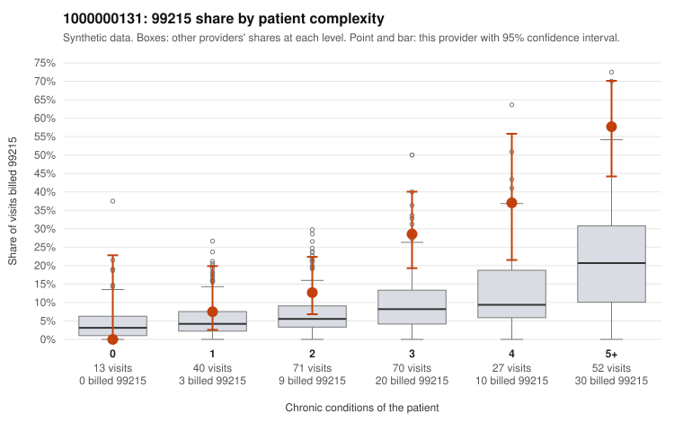

# 1000000131: 1000000131: documented 99215 claims mostly support the level billed (0% below)

**Leaning (advisory):** Pattern consistent with a high-acuity panel

## Why

1000000131 billed 99215 on 26.4% of 273 claims against an expected 9.1% given patient complexity (risk-adjusted score 3.72; plain z-score vs peers 3.31). 4% of this provider's 99215 claims were on patients with 0 or 1 chronic conditions. Records came back for 28 claims. Of 8 documented 99215 claims, 0 (0%) were documented below the billed level, against 29% for the comparison providers. Note checks on 28 returned notes (share showing each sign): problems 0%, late 4%, unsigned 0%, data 0%. No audit trail was received. 0 of 19 notes claiming moderate-or-higher data reviewed had no lab or test line on the claim. This pattern is consistent with a high-acuity panel. The sampled documentation supports the billed level. Examples: C0067522: billed 99215, patient aged 66 with 5 chronic condition(s) (type 2 diabetes;heart failure;COPD;asthma;chronic kidney disease); documented MDM level high, 46 minutes. C0067525: billed 99215, patient aged 70 with 5 chronic condition(s) (obesity;hyperlipidemia;depression;hypertension;osteoarthritis); documented MDM level high, minutes not recorded. C0067653: billed 99215; documented MDM level high, minutes not recorded.

## Evidence chart

## Cited claims

`C0067522`, `C0067525`, `C0067653`

## Suggested next steps

- Do not pursue recovery on this evidence: 28 charts came back and they support the level billed (0 of 8 documented 99215 claims below the billed level).
- Revisit if the 99215 share keeps rising against peers or a larger sample shows unsupported claims.

---
Citations checked: 3/3 valid. Synthetic data. The leaning is advisory; the flag comes from the statistical screen, and no clinical documentation is available beyond the sampled records-review facts shown in the packet.
