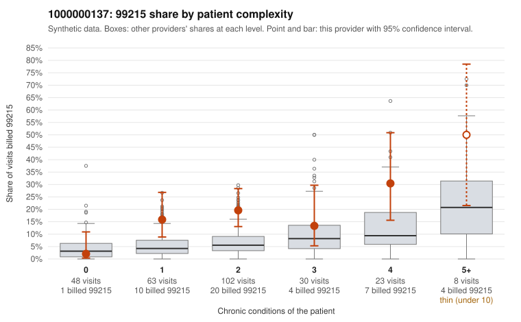

# 1000000137: 1000000137: documented 99215 claims mostly support the level billed (22% below)

**Leaning (advisory):** Pattern consistent with a high-acuity panel

## Why

1000000137 billed 99215 on 16.8% of 274 claims against an expected 5.7% given patient complexity (risk-adjusted score 2.90; plain z-score vs peers 1.65). 24% of this provider's 99215 claims were on patients with 0 or 1 chronic conditions. Records came back for 45 claims. Of 18 documented 99215 claims, 4 (22%) were documented below the billed level, against 29% for the comparison providers. Note checks on 45 returned notes (share showing each sign): problems 11%, late 9%, unsigned 0%, data 0%. No audit trail was received. 2 of 33 notes claiming moderate-or-higher data reviewed had no lab or test line on the claim. This pattern is consistent with a high-acuity panel. The sampled documentation supports the billed level. Examples: C0069016: billed 99215; documented MDM level high, 51 minutes. C0069103: billed 99215, patient aged 58 with 1 chronic condition(s) (depression); documented MDM level high, 45 minutes. C0069132: billed 99215, patient aged 20 with 1 chronic condition(s) (atrial fibrillation); documented MDM level high, 54 minutes. C0069036: billed 99215, patient aged 43 with 4 chronic condition(s) (obesity;hyperlipidemia;osteoarthritis;chronic kidney disease). C0069117: billed 99215, patient aged 79 with 4 chronic condition(s) (hypothyroidism;type 2 diabetes;depression;hypertension).

## Evidence chart

## Cited claims

`C0069016`, `C0069103`, `C0069132`, `C0069036`, `C0069117`

## Suggested next steps

- Do not pursue recovery on this evidence: 45 charts came back and they support the level billed (4 of 18 documented 99215 claims below the billed level).
- Revisit if the 99215 share keeps rising against peers or a larger sample shows unsupported claims.

---
Citations checked: 5/5 valid. Synthetic data. The leaning is advisory; the flag comes from the statistical screen, and no clinical documentation is available beyond the sampled records-review facts shown in the packet.
