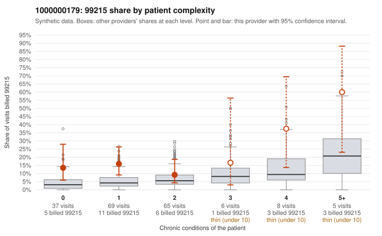

# 1000000179: 1000000179: too few returned records to judge

**Leaning (advisory):** Inconclusive

## Why

1000000179 billed 99215 on 15.3% of 190 claims against an expected 5.1% given patient complexity (risk-adjusted score 2.31; plain z-score vs peers 1.38). 55% of this provider's 99215 claims were on patients with 0 or 1 chronic conditions. Records came back for 30 claims. Of 3 documented 99215 claims, 0 (0%) were documented below the billed level, against 29% for the comparison providers. Note checks on 30 returned notes (share showing each sign): problems 17%, late 3%, unsigned 0%, data 0%. No audit trail was received. 0 of 14 notes claiming moderate-or-higher data reviewed had no lab or test line on the claim. The evidence does not support a call either way yet. Examples: C0091387: billed 99213; documented MDM level straightforward, minutes not recorded. C0091473: billed 99214; documented MDM level low, minutes not recorded. C0091367: billed 99215, patient aged 55 with 1 chronic condition(s) (hypothyroidism); documented MDM level high, 45 minutes. C0091370: billed 99215, patient aged 69 with 1 chronic condition(s) (heart failure).

## Evidence chart

## Cited claims

`C0091387`, `C0091473`, `C0091367`, `C0091370`

## Suggested next steps

- 30 charts came back but do not settle it: request a targeted sample of 99215 charts, starting with C0091387, C0091473, C0091367.
- Re-check after the targeted charts arrive; do not call upcoding or a sicker panel on this evidence alone.

---
Citations checked: 4/4 valid. Synthetic data. The leaning is advisory; the flag comes from the statistical screen, and no clinical documentation is available beyond the sampled records-review facts shown in the packet.
