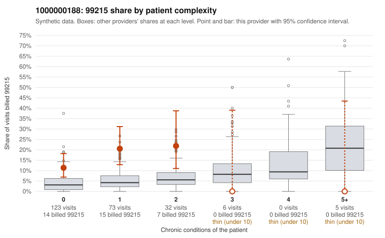

# 1000000188: 1000000188: 1 of 18 documented 99215 claims (6%) are documented below the billed level

**Leaning (advisory):** Pattern consistent with upcoding

## Why

1000000188 billed 99215 on 15.1% of 239 claims against an expected 4.0% given patient complexity (risk-adjusted score 3.21; plain z-score vs peers 1.35). 81% of this provider's 99215 claims were on patients with 0 or 1 chronic conditions. Records came back for 45 claims. Of 18 documented 99215 claims, 1 (6%) were documented below the billed level, against 29% for the comparison providers. Note checks on 45 returned notes (share showing each sign): problems 44%, late 20%, unsigned 0%, data 31%. No audit trail was received. 15 of 36 notes claiming moderate-or-higher data reviewed had no lab or test line on the claim. This pattern is consistent with upcoding. It is a reason to review the records, not a finding. Examples: C0095067: billed 99215, patient aged 43 with 0 chronic condition(s); documented MDM level moderate, minutes not recorded. C0094984: billed 99215, patient aged 69 with 0 chronic condition(s). C0094990: billed 99215, patient aged 52 with 1 chronic condition(s) (hypertension). C0094996: billed 99215, patient aged 64 with 0 chronic condition(s).

## Evidence chart

## Cited claims

`C0095067`, `C0094984`, `C0094990`, `C0094996`

## Suggested next steps

- Request the full charts for C0095067, C0094984, C0094990 and have a certified coder re-score each against the current E/M rules (medical decision making or total time).
- If the re-scoring confirms the pattern, review the random sample in the recovery packet's sampling plan before any overpayment estimate; do not extrapolate from a targeted sample.
- Look at the notes themselves: 44% address fewer problems than their level implies and 20% were signed late; request the audit trail for C0095067, C0094984, C0094990.

---
Citations checked: 4/4 valid. Synthetic data. The leaning is advisory; the flag comes from the statistical screen, and no clinical documentation is available beyond the sampled records-review facts shown in the packet.
