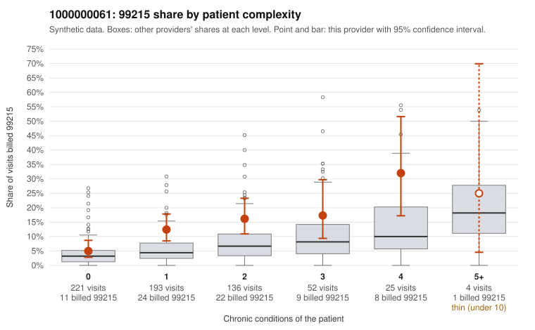

# 1000000061: 1000000061: documented 99215 claims mostly support the level billed (17% below)

**Leaning (advisory):** Pattern consistent with a high-acuity panel

## Why

1000000061 billed 99215 on 11.9% of 631 claims against an expected 4.9% given patient complexity (risk-adjusted score 3.19; plain z-score vs peers 0.96). 47% of this provider's 99215 claims were on patients with 0 or 1 chronic conditions. Records came back for 30 claims. Of 6 documented 99215 claims, 1 (17%) were documented below the billed level, against 47% for the comparison providers. Note checks on 30 returned notes (share showing each sign): problems 17%, late 3%, unsigned 0%, data 7%. No audit trail was received. 3 of 23 notes claiming moderate-or-higher data reviewed had no lab or test line on the claim. This pattern is consistent with a high-acuity panel. The sampled documentation supports the billed level. Examples: C0023273: billed 99215, patient aged 42 with 4 chronic condition(s) (type 2 diabetes;hypertension;atrial fibrillation;chronic kidney disease); documented MDM level high, 48 minutes. C0023478: billed 99215; documented MDM level high, minutes not recorded. C0023486: billed 99215; documented MDM level high, minutes not recorded. C0023326: billed 99215, patient aged 46 with 5 chronic condition(s) (hypothyroidism;hypertension;heart failure;COPD;asthma).

## Evidence chart

## Cited claims

`C0023273`, `C0023478`, `C0023486`, `C0023326`

## Suggested next steps

- Do not pursue recovery on this evidence: 30 charts came back and they support the level billed (1 of 6 documented 99215 claims below the billed level).
- Revisit if the 99215 share keeps rising against peers or a larger sample shows unsupported claims.

---
Citations checked: 4/4 valid. Synthetic data. The leaning is advisory; the flag comes from the statistical screen, and no clinical documentation is available beyond the sampled records-review facts shown in the packet.
