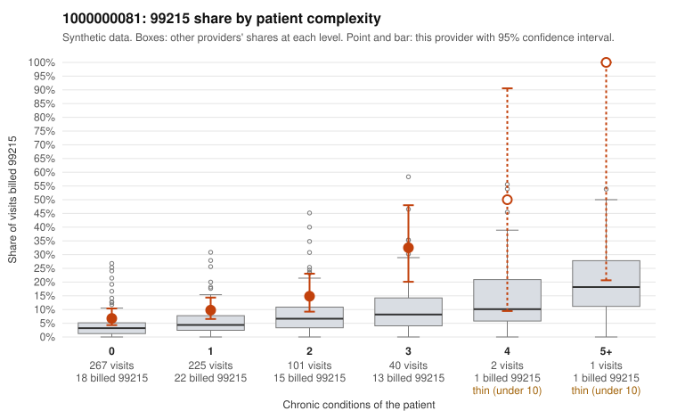

# 1000000081: 1000000081: too few returned records to judge

**Leaning (advisory):** Inconclusive

## Why

1000000081 billed 99215 on 11.0% of 636 claims against an expected 4.4% given patient complexity (risk-adjusted score 3.21; plain z-score vs peers 0.78). 57% of this provider's 99215 claims were on patients with 0 or 1 chronic conditions. Records came back for 30 claims. Of 5 documented 99215 claims, 1 (20%) were documented below the billed level, against 47% for the comparison providers. Note checks on 30 returned notes (share showing each sign): problems 33%, late 0%, unsigned 0%, data 3%. No audit trail was received. 1 of 17 notes claiming moderate-or-higher data reviewed had no lab or test line on the claim. The evidence does not support a call either way yet. Examples: C0031485: billed 99215; documented MDM level moderate, 38 minutes. C0031437: billed 99215, patient aged 59 with 1 chronic condition(s) (COPD). C0031461: billed 99215, patient aged 52 with 0 chronic condition(s).

## Evidence chart

## Cited claims

`C0031485`, `C0031437`, `C0031461`

## Suggested next steps

- 30 charts came back but do not settle it: request a targeted sample of 99215 charts, starting with C0031485, C0031437, C0031461.
- Re-check after the targeted charts arrive; do not call upcoding or a sicker panel on this evidence alone.

---
Citations checked: 3/3 valid. Synthetic data. The leaning is advisory; the flag comes from the statistical screen, and no clinical documentation is available beyond the sampled records-review facts shown in the packet.
