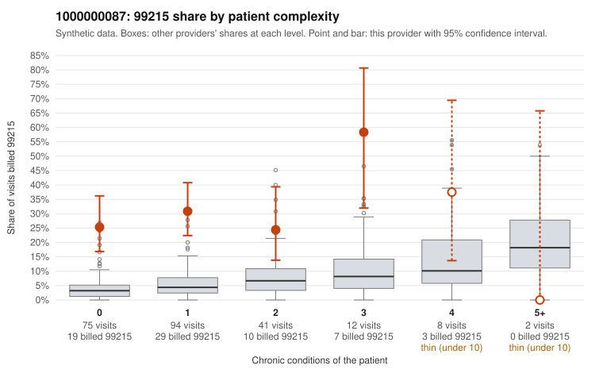

# 1000000087: 1000000087: too few returned records to judge

**Leaning (advisory):** Inconclusive

## Why

1000000087 billed 99215 on 29.3% of 232 claims against an expected 4.8% given patient complexity (risk-adjusted score 6.96; plain z-score vs peers 4.40). 71% of this provider's 99215 claims were on patients with 0 or 1 chronic conditions. Records came back for 45 claims. Of 20 documented 99215 claims, 11 (55%) were documented below the billed level, against 47% for the comparison providers. Note checks on 45 returned notes (share showing each sign): problems 31%, late 0%, unsigned 0%, data 0%. No audit trail was received. 3 of 34 notes claiming moderate-or-higher data reviewed had no lab or test line on the claim. The evidence does not support a call either way yet. Examples: C0034175: billed 99215; documented MDM level moderate, minutes not recorded. C0034218: billed 99215, patient aged 42 with 1 chronic condition(s) (obesity); documented MDM level moderate, 26 minutes. C0034202: billed 99215, patient aged 58 with 1 chronic condition(s) (hyperlipidemia). C0034206: billed 99215, patient aged 40 with 0 chronic condition(s).

## Evidence chart

## Cited claims

`C0034175`, `C0034218`, `C0034202`, `C0034206`

## Suggested next steps

- 45 charts came back but do not settle it: request a targeted sample of 99215 charts, starting with C0034175, C0034218, C0034202.
- Re-check after the targeted charts arrive; do not call upcoding or a sicker panel on this evidence alone.

---
Citations checked: 4/4 valid. Synthetic data. The leaning is advisory; the flag comes from the statistical screen, and no clinical documentation is available beyond the sampled records-review facts shown in the packet.
