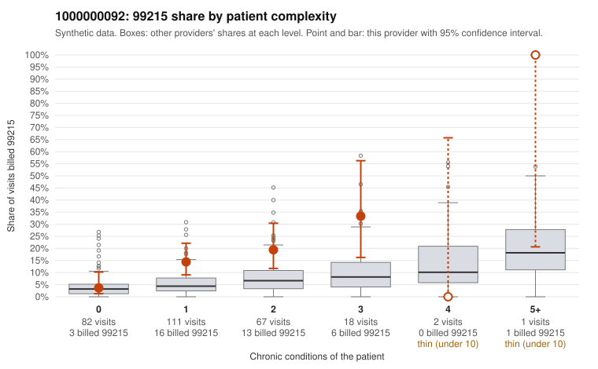

# 1000000092: 1000000092: documented 99215 claims mostly support the level billed (18% below)

**Leaning (advisory):** Pattern consistent with a high-acuity panel

## Why

1000000092 billed 99215 on 13.9% of 281 claims against an expected 4.7% given patient complexity (risk-adjusted score 2.83; plain z-score vs peers 1.35). 49% of this provider's 99215 claims were on patients with 0 or 1 chronic conditions. Records came back for 45 claims. Of 17 documented 99215 claims, 3 (18%) were documented below the billed level, against 47% for the comparison providers. Note checks on 45 returned notes (share showing each sign): problems 31%, late 0%, unsigned 0%, data 11%. No audit trail was received. 5 of 34 notes claiming moderate-or-higher data reviewed had no lab or test line on the claim. This pattern is consistent with a high-acuity panel. The sampled documentation supports the billed level. Examples: C0038529: billed 99215; documented MDM level high, 31 minutes. C0038586: billed 99215, patient aged 31 with 1 chronic condition(s) (hypertension); documented MDM level high, minutes not recorded. C0038625: billed 99215; documented MDM level high, 49 minutes. C0038598: billed 99215, patient aged 65 with 5 chronic condition(s) (type 2 diabetes;obesity;hypertension;heart failure;osteoarthritis).

## Evidence chart

## Cited claims

`C0038529`, `C0038586`, `C0038625`, `C0038598`

## Suggested next steps

- Do not pursue recovery on this evidence: 45 charts came back and they support the level billed (3 of 17 documented 99215 claims below the billed level).
- Revisit if the 99215 share keeps rising against peers or a larger sample shows unsupported claims.

---
Citations checked: 4/4 valid. Synthetic data. The leaning is advisory; the flag comes from the statistical screen, and no clinical documentation is available beyond the sampled records-review facts shown in the packet.
