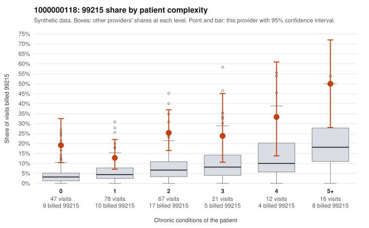

# 1000000118: 1000000118: 0 of 9 documented 99215 claims (0%) are documented below the billed level

**Leaning (advisory):** Pattern consistent with upcoding

## Why

1000000118 billed 99215 on 22.0% of 241 claims against an expected 6.2% given patient complexity (risk-adjusted score 4.06; plain z-score vs peers 2.96). 36% of this provider's 99215 claims were on patients with 0 or 1 chronic conditions. Records came back for 29 claims. Of 9 documented 99215 claims, 0 (0%) were documented below the billed level, against 47% for the comparison providers. Note checks on 29 returned notes (share showing each sign): problems 28%, late 14%, unsigned 0%, data 7%, bulk created 7%, paste heavy 7%. 3 of 20 notes claiming moderate-or-higher data reviewed had no lab or test line on the claim. This pattern is consistent with upcoding. It is a reason to review the records, not a finding. Examples: C0054987: billed 99214; documented MDM level low, minutes not recorded. C0054971: billed 99215, patient aged 51 with 0 chronic condition(s); documented MDM level high, 45 minutes. C0054979: billed 99215, patient aged 62 with 1 chronic condition(s) (obesity). C0054984: billed 99215, patient aged 31 with 1 chronic condition(s) (obesity).

## Evidence chart

## Cited claims

`C0054987`, `C0054971`, `C0054979`, `C0054984`

## Suggested next steps

- Request the full charts for C0054987, C0054971, C0054979 and have a certified coder re-score each against the current E/M rules (medical decision making or total time).
- If the re-scoring confirms the pattern, review the random sample in the recovery packet's sampling plan before any overpayment estimate; do not extrapolate from a targeted sample.
- Look at the notes themselves: 28% address fewer problems than their level implies and 14% were signed late; request the audit trail for C0054987, C0054971, C0054979.

---
Citations checked: 4/4 valid. Synthetic data. The leaning is advisory; the flag comes from the statistical screen, and no clinical documentation is available beyond the sampled records-review facts shown in the packet.
