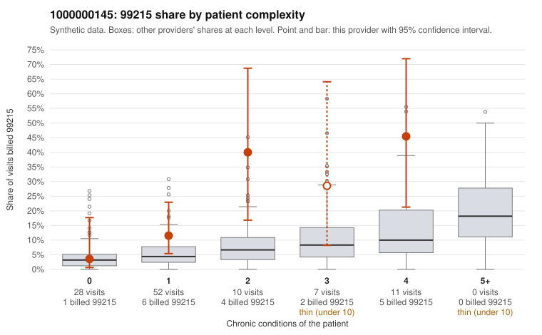

# 1000000145: 1000000145: too few returned records to judge

**Leaning (advisory):** Inconclusive

## Why

1000000145 billed 99215 on 16.7% of 108 claims against an expected 5.1% given patient complexity (risk-adjusted score 2.13; plain z-score vs peers 1.90). 39% of this provider's 99215 claims were on patients with 0 or 1 chronic conditions. Records came back for 6 claims. No documented 99215 claims came back. 1 of 4 notes claiming moderate-or-higher data reviewed had no lab or test line on the claim. The evidence does not support a call either way yet. Examples: C0064786: billed 99215, patient aged 52 with 1 chronic condition(s) (chronic kidney disease). C0064806: billed 99215, patient aged 52 with 0 chronic condition(s).

## Evidence chart

## Cited claims

`C0064786`, `C0064806`

## Suggested next steps

- 6 charts came back but do not settle it: request a targeted sample of 99215 charts, starting with C0064786, C0064806.
- Re-check after the targeted charts arrive; do not call upcoding or a sicker panel on this evidence alone.

---
Citations checked: 2/2 valid. Synthetic data. The leaning is advisory; the flag comes from the statistical screen, and no clinical documentation is available beyond the sampled records-review facts shown in the packet.
