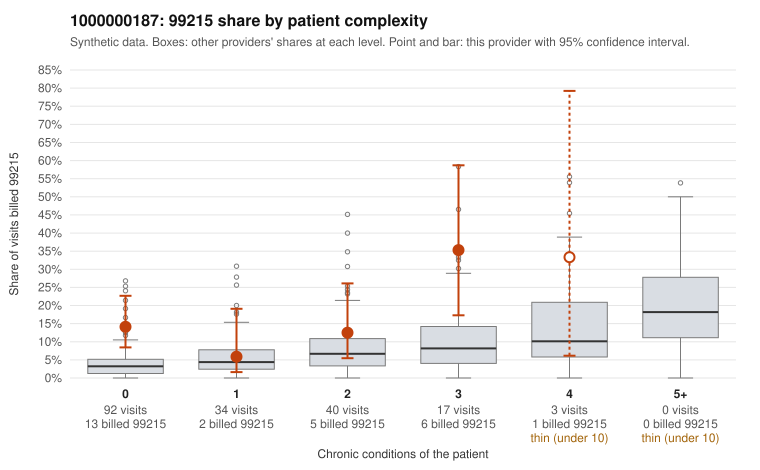

# 1000000187: 1000000187: too few returned records to judge

**Leaning (advisory):** Inconclusive

## Why

1000000187 billed 99215 on 14.5% of 186 claims against an expected 4.5% given patient complexity (risk-adjusted score 2.57; plain z-score vs peers 1.48). 56% of this provider's 99215 claims were on patients with 0 or 1 chronic conditions. Records came back for 45 claims. Of 20 documented 99215 claims, 7 (35%) were documented below the billed level, against 47% for the comparison providers. Note checks on 45 returned notes (share showing each sign): problems 42%, late 4%, unsigned 0%, data 7%, bulk created 0%, paste heavy 0%. 5 of 31 notes claiming moderate-or-higher data reviewed had no lab or test line on the claim. The evidence does not support a call either way yet. Examples: C0082044: billed 99215, patient aged 63 with 4 chronic condition(s) (type 2 diabetes;obesity;depression;hypertension); documented MDM level moderate, minutes not recorded. C0082068: billed 99215, patient aged 55 with 1 chronic condition(s) (hypertension); documented MDM level moderate, 34 minutes. C0082059: billed 99215, patient aged 35 with 0 chronic condition(s); documented MDM level high, 47 minutes.

## Evidence chart

## Cited claims

`C0082044`, `C0082068`, `C0082059`

## Suggested next steps

- 45 charts came back but do not settle it: request a targeted sample of 99215 charts, starting with C0082044, C0082068, C0082059.
- Re-check after the targeted charts arrive; do not call upcoding or a sicker panel on this evidence alone.

---
Citations checked: 3/3 valid. Synthetic data. The leaning is advisory; the flag comes from the statistical screen, and no clinical documentation is available beyond the sampled records-review facts shown in the packet.
