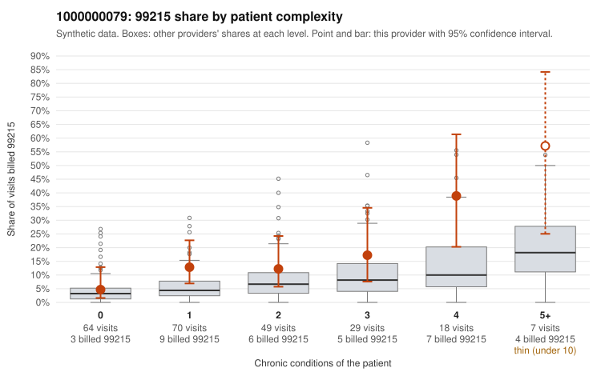

# Payment Integrity dossier: 1000000079

> Draft for human review. Statistical and records-sample evidence only; not a finding. Compliance or legal review is needed before any provider contact, notice or recoupment.

## Provider overview

| | |
|---|---|
| Specialty / state | Family Practice, GA (synthetic) |
| Claims / patients | 237 / 113 |
| Billed mix (99211 to 99215) | 5 / 14 / 93 / 91 / 34 |
| 99215 share | 14.3% |
| Expected 99215 share given patient complexity | 5.7% |
| Screen scores | z vs peers 1.45; risk-adjusted 2.25; flagged by eb_ratio_t |

## Case summary (advisory)

**1000000079: 8 of 15 documented 99214 and 99215 claims (53%) are documented below the billed level**

Leaning: pattern consistent with upcoding. Citations checked: 5/5 valid.

1000000079 billed 99215 on 14.3% of 237 claims against an expected 5.7% given patient complexity (risk-adjusted score 2.25; plain z-score vs peers 1.45). 35% of this provider's 99215 claims were on patients with 0 or 1 chronic conditions. Records came back for 30 claims. Of 3 documented 99215 claims, 3 (100%) were documented below the billed level, against 47% for the comparison providers. Note checks on 30 returned notes (share showing each sign): problems 10%, late 10%, unsigned 0%, data 0%. No audit trail was received. 1 of 12 notes claiming moderate-or-higher data reviewed had no lab or test line on the claim. This pattern is consistent with upcoding. It is a reason to review the records, not a finding. Examples: C0031003: billed 99215, patient aged 47 with 1 chronic condition(s) (depression); documented MDM level moderate, 39 minutes. C0031053: billed 99215, patient aged 96 with 4 chronic condition(s) (type 2 diabetes;hypertension;osteoarthritis;chronic kidney disease); documented MDM level moderate, 38 minutes. C0031078: billed 99215, patient aged 77 with 4 chronic condition(s) (type 2 diabetes;hyperlipidemia;hypertension;COPD); documented MDM level moderate, minutes not recorded. C0031016: billed 99215, patient aged 20 with 1 chronic condition(s) (hypertension). C0031032: billed 99215, patient aged 25 with 1 chronic condition(s) (chronic kidney disease).

## Evidence chart

## Records-review sample so far

Documentation is on file for 30 claims (13% of this provider's claims).

| Billed | Documented | Documentation below billed level | Rate | All-provider rate |
|---|---|---|---|---|
| 99213 | 13 | 0 | 0.0% | 2.1% |
| 99214 | 12 | 5 | 41.7% | 3.4% |
| 99215 | 3 | 3 | 100.0% | 46.7% |

## Recommended next steps for Payment Integrity

1. Request records for the sampled claims in `record_request_list.csv` (23 claims across 99215).
2. Review the records against E/M documentation rules and record the supported level for each claim.
3. Run the overpayment estimator on the reviewed sample (`sampling_plan.md` explains how).
4. Notice, appeal rights, recoupment, education or corrective action, and any referral are decisions for the PI team, compliance and counsel. Nothing here drafts those.

Suggested follow-ups from the case summary:

- Request the full charts for C0031003, C0031053, C0031078 and have a certified coder re-score each against the current E/M rules (medical decision making or total time).
- If the re-scoring confirms the pattern, review the random sample in the recovery packet's sampling plan before any overpayment estimate; do not extrapolate from a targeted sample.
- Look at the notes themselves: 10% address fewer problems than their level implies and 10% were signed late; request the audit trail for C0031003, C0031053, C0031078.

## Limits

- Synthetic data; no real claims or providers.
- The leaning is advisory. The flag comes from the statistical screen; the summary explains it.
- The records-review sample is partial and was simulated for this project.
- Allowed amounts are GA Family Practice averages from a public CMS file, not this provider's actual payments.
