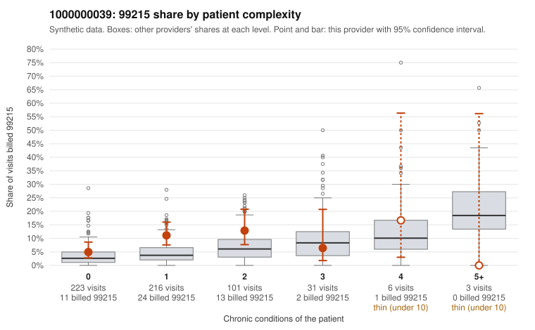

# 1000000039: 1000000039: too few returned records to judge

**Leaning (advisory):** Inconclusive

## Why

1000000039 billed 99215 on 8.8% of 580 claims against an expected 3.8% given patient complexity (risk-adjusted score 2.47; plain z-score vs peers 0.44). 69% of this provider's 99215 claims were on patients with 0 or 1 chronic conditions. Records came back for 30 claims. Of 2 documented 99215 claims, 1 (50%) were documented below the billed level, against 43% for the comparison providers. Note checks on 30 returned notes (share showing each sign): problems 27%, late 0%, unsigned 0%, data 3%. No audit trail was received. 2 of 19 notes claiming moderate-or-higher data reviewed had no lab or test line on the claim. The evidence does not support a call either way yet. Examples: C0018740: billed 99215, patient aged 59 with 1 chronic condition(s) (depression); documented MDM level moderate, 20 minutes. C0018244: billed 99215, patient aged 65 with 1 chronic condition(s) (COPD). C0018257: billed 99215, patient aged 58 with 1 chronic condition(s) (chronic kidney disease).

## Evidence chart

## Cited claims

`C0018740`, `C0018244`, `C0018257`

## Suggested next steps

- 30 charts came back but do not settle it: request a targeted sample of 99215 charts, starting with C0018740, C0018244, C0018257.
- Re-check after the targeted charts arrive; do not call upcoding or a sicker panel on this evidence alone.

---
Citations checked: 3/3 valid. Synthetic data. The leaning is advisory; the flag comes from the statistical screen, and no clinical documentation is available beyond the sampled records-review facts shown in the packet.
