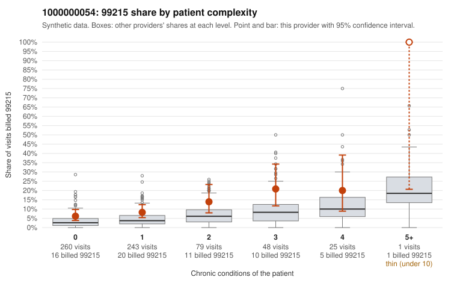

# 1000000054: 1000000054: documented 99215 claims mostly support the level billed (6% below)

**Leaning (advisory):** Pattern consistent with a high-acuity panel

## Why

1000000054 billed 99215 on 9.6% of 656 claims against an expected 3.8% given patient complexity (risk-adjusted score 3.01; plain z-score vs peers 0.60). 57% of this provider's 99215 claims were on patients with 0 or 1 chronic conditions. Records came back for 45 claims. Of 16 documented 99215 claims, 1 (6%) were documented below the billed level, against 43% for the comparison providers. Note checks on 45 returned notes (share showing each sign): problems 29%, late 4%, unsigned 0%, data 9%. No audit trail was received. 4 of 37 notes claiming moderate-or-higher data reviewed had no lab or test line on the claim. This pattern is consistent with a high-acuity panel. The sampled documentation supports the billed level. Examples: C0024637: billed 99215; documented MDM level high, 53 minutes. C0024855: billed 99215; documented MDM level high, 38 minutes. C0024911: billed 99215, patient aged 79 with 1 chronic condition(s) (COPD); documented MDM level high, 54 minutes. C0024624: billed 99215, patient aged 54 with 4 chronic condition(s) (type 2 diabetes;hyperlipidemia;depression;atrial fibrillation). C0024646: billed 99215, patient aged 50 with 4 chronic condition(s) (hyperlipidemia;atrial fibrillation;asthma;osteoarthritis).

## Evidence chart

## Cited claims

`C0024637`, `C0024855`, `C0024911`, `C0024624`, `C0024646`

## Suggested next steps

- Do not pursue recovery on this evidence: 45 charts came back and they support the level billed (1 of 16 documented 99215 claims below the billed level).
- Revisit if the 99215 share keeps rising against peers or a larger sample shows unsupported claims.

---
Citations checked: 5/5 valid. Synthetic data. The leaning is advisory; the flag comes from the statistical screen, and no clinical documentation is available beyond the sampled records-review facts shown in the packet.
