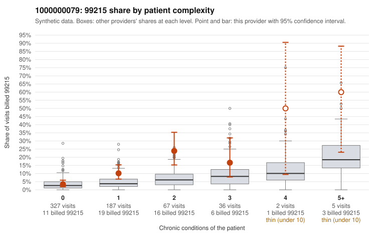

# 1000000079: 1000000079: too few returned records to judge

**Leaning (advisory):** Inconclusive

## Why

1000000079 billed 99215 on 9.0% of 624 claims against an expected 3.5% given patient complexity (risk-adjusted score 2.90; plain z-score vs peers 0.48). 54% of this provider's 99215 claims were on patients with 0 or 1 chronic conditions. Records came back for 45 claims. Of 18 documented 99215 claims, 6 (33%) were documented below the billed level, against 43% for the comparison providers. Note checks on 45 returned notes (share showing each sign): problems 53%, late 2%, unsigned 0%, data 2%, bulk created 0%, paste heavy 0%. 3 of 34 notes claiming moderate-or-higher data reviewed had no lab or test line on the claim. The evidence does not support a call either way yet. Examples: C0038266: billed 99215; documented MDM level moderate, minutes not recorded. C0038321: billed 99215; documented MDM level moderate, minutes not recorded. C0038224: billed 99215, patient aged 52 with 0 chronic condition(s). C0038267: billed 99215, patient aged 39 with 1 chronic condition(s) (depression).

## Evidence chart

## Cited claims

`C0038266`, `C0038321`, `C0038224`, `C0038267`

## Suggested next steps

- 45 charts came back but do not settle it: request a targeted sample of 99215 charts, starting with C0038266, C0038321, C0038224.
- Re-check after the targeted charts arrive; do not call upcoding or a sicker panel on this evidence alone.

---
Citations checked: 4/4 valid. Synthetic data. The leaning is advisory; the flag comes from the statistical screen, and no clinical documentation is available beyond the sampled records-review facts shown in the packet.
