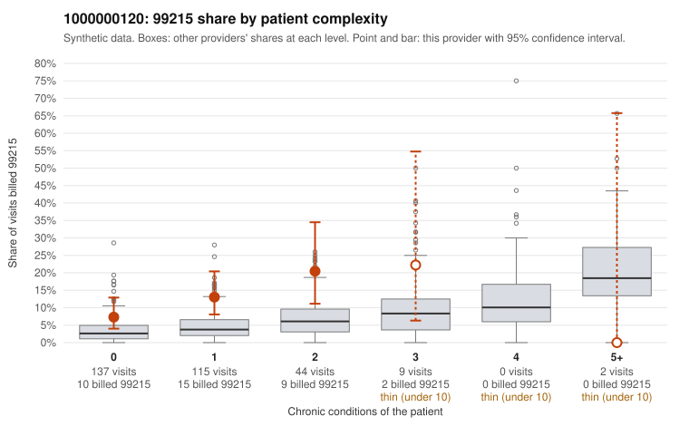

# 1000000120: 1000000120: too few returned records to judge

**Leaning (advisory):** Inconclusive

## Why

1000000120 billed 99215 on 11.7% of 307 claims against an expected 3.5% given patient complexity (risk-adjusted score 3.06; plain z-score vs peers 1.03). 69% of this provider's 99215 claims were on patients with 0 or 1 chronic conditions. Records came back for 30 claims. Of 3 documented 99215 claims, 2 (67%) were documented below the billed level, against 43% for the comparison providers. Note checks on 30 returned notes (share showing each sign): problems 33%, late 10%, unsigned 0%, data 0%. No audit trail was received. 0 of 19 notes claiming moderate-or-higher data reviewed had no lab or test line on the claim. The evidence does not support a call either way yet. Examples: C0060194: billed 99215, patient aged 72 with 0 chronic condition(s); documented MDM level moderate, minutes not recorded. C0060383: billed 99215, patient aged 42 with 0 chronic condition(s); documented MDM level moderate, 32 minutes. C0060104: billed 99215, patient aged 64 with 1 chronic condition(s) (type 2 diabetes). C0060108: billed 99215, patient aged 50 with 0 chronic condition(s).

## Evidence chart

## Cited claims

`C0060194`, `C0060383`, `C0060104`, `C0060108`

## Suggested next steps

- 30 charts came back but do not settle it: request a targeted sample of 99215 charts, starting with C0060194, C0060383, C0060104.
- Re-check after the targeted charts arrive; do not call upcoding or a sicker panel on this evidence alone.

---
Citations checked: 4/4 valid. Synthetic data. The leaning is advisory; the flag comes from the statistical screen, and no clinical documentation is available beyond the sampled records-review facts shown in the packet.
