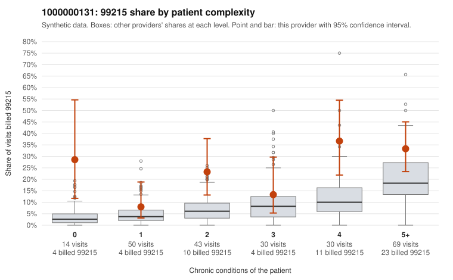

# 1000000131: 1000000131: too few returned records to judge

**Leaning (advisory):** Inconclusive

## Why

1000000131 billed 99215 on 23.7% of 236 claims against an expected 9.2% given patient complexity (risk-adjusted score 3.09; plain z-score vs peers 3.42). 14% of this provider's 99215 claims were on patients with 0 or 1 chronic conditions. Records came back for 30 claims. Of 9 documented 99215 claims, 6 (67%) were documented below the billed level, against 43% for the comparison providers. Note checks on 30 returned notes (share showing each sign): problems 10%, late 0%, unsigned 0%, data 0%. No audit trail was received. 0 of 18 notes claiming moderate-or-higher data reviewed had no lab or test line on the claim. The evidence does not support a call either way yet. Examples: C0067084: billed 99215, patient aged 76 with 4 chronic condition(s) (obesity;hyperlipidemia;depression;atrial fibrillation); documented MDM level moderate, 36 minutes. C0067107: billed 99215; documented MDM level moderate, minutes not recorded. C0067044: billed 99215, patient aged 41 with 0 chronic condition(s). C0067201: billed 99215, patient aged 45 with 0 chronic condition(s).

## Evidence chart

## Cited claims

`C0067084`, `C0067107`, `C0067044`, `C0067201`

## Suggested next steps

- 30 charts came back but do not settle it: request a targeted sample of 99215 charts, starting with C0067084, C0067107, C0067044.
- Re-check after the targeted charts arrive; do not call upcoding or a sicker panel on this evidence alone.

---
Citations checked: 4/4 valid. Synthetic data. The leaning is advisory; the flag comes from the statistical screen, and no clinical documentation is available beyond the sampled records-review facts shown in the packet.
