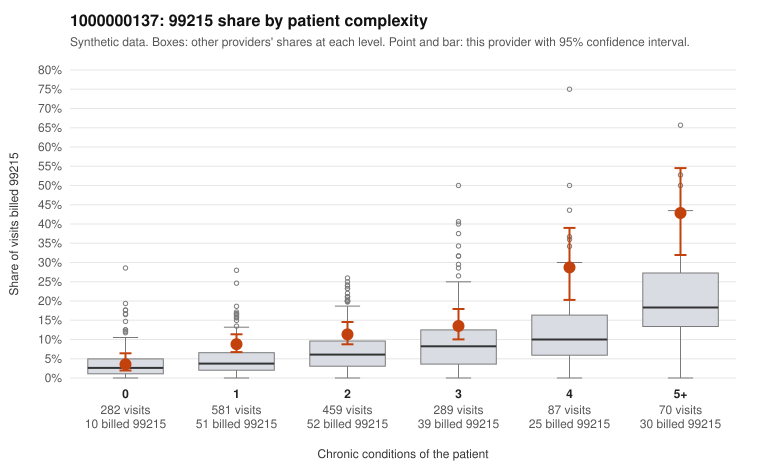

# 1000000137: 1000000137: too few returned records to judge

**Leaning (advisory):** Inconclusive

## Why

1000000137 billed 99215 on 11.7% of 1,768 claims against an expected 5.3% given patient complexity (risk-adjusted score 4.87; plain z-score vs peers 1.02). 29% of this provider's 99215 claims were on patients with 0 or 1 chronic conditions. Records came back for 30 claims. Of 1 documented 99215 claims, 0 (0%) were documented below the billed level, against 43% for the comparison providers. Note checks on 30 returned notes (share showing each sign): problems 30%, late 7%, unsigned 0%, data 3%. No audit trail was received. 1 of 15 notes claiming moderate-or-higher data reviewed had no lab or test line on the claim. The evidence does not support a call either way yet. Examples: C0069193: billed 99213; documented MDM level straightforward, 10 minutes. C0070534: billed 99214; documented MDM level low, minutes not recorded. C0068789: billed 99215, patient aged 29 with 1 chronic condition(s) (type 2 diabetes). C0068848: billed 99215, patient aged 41 with 1 chronic condition(s) (COPD).

## Evidence chart

## Cited claims

`C0069193`, `C0070534`, `C0068789`, `C0068848`

## Suggested next steps

- 30 charts came back but do not settle it: request a targeted sample of 99215 charts, starting with C0069193, C0070534, C0068789.
- Re-check after the targeted charts arrive; do not call upcoding or a sicker panel on this evidence alone.

---
Citations checked: 4/4 valid. Synthetic data. The leaning is advisory; the flag comes from the statistical screen, and no clinical documentation is available beyond the sampled records-review facts shown in the packet.
