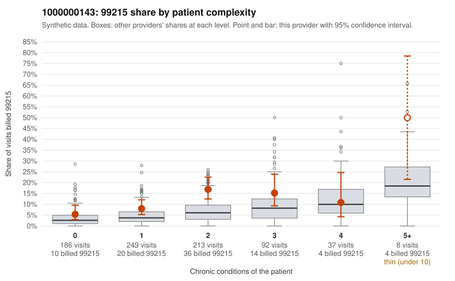

# 1000000143: 1000000143: too few returned records to judge

**Leaning (advisory):** Inconclusive

## Why

1000000143 billed 99215 on 11.2% of 785 claims against an expected 4.6% given patient complexity (risk-adjusted score 3.49; plain z-score vs peers 0.92). 34% of this provider's 99215 claims were on patients with 0 or 1 chronic conditions. Records came back for 30 claims. Of 4 documented 99215 claims, 0 (0%) were documented below the billed level, against 43% for the comparison providers. Note checks on 30 returned notes (share showing each sign): problems 23%, late 0%, unsigned 0%, data 0%. No audit trail was received. 2 of 20 notes claiming moderate-or-higher data reviewed had no lab or test line on the claim. The evidence does not support a call either way yet. Examples: C0075114: billed 99214, patient aged 75 with 3 chronic condition(s) (type 2 diabetes;hypertension;atrial fibrillation); documented MDM level low, minutes not recorded. C0075649: billed 99213; documented MDM level straightforward, minutes not recorded. C0075025: billed 99215, patient aged 38 with 0 chronic condition(s). C0075080: billed 99215, patient aged 67 with 1 chronic condition(s) (obesity).

## Evidence chart

## Cited claims

`C0075114`, `C0075649`, `C0075025`, `C0075080`

## Suggested next steps

- 30 charts came back but do not settle it: request a targeted sample of 99215 charts, starting with C0075114, C0075649, C0075025.
- Re-check after the targeted charts arrive; do not call upcoding or a sicker panel on this evidence alone.

---
Citations checked: 4/4 valid. Synthetic data. The leaning is advisory; the flag comes from the statistical screen, and no clinical documentation is available beyond the sampled records-review facts shown in the packet.
