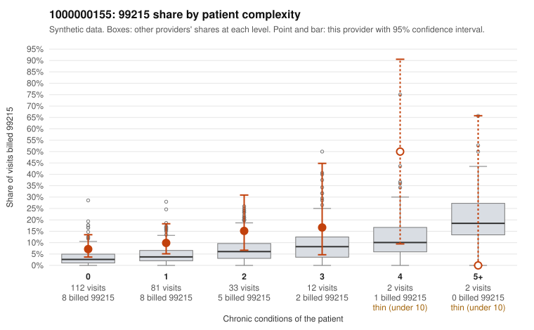

# 1000000155: 1000000155: 8 of 15 documented 99214 and 99215 claims (53%) are documented below the billed level

**Leaning (advisory):** Pattern consistent with upcoding

## Why

1000000155 billed 99215 on 9.9% of 242 claims against an expected 3.6% given patient complexity (risk-adjusted score 2.00; plain z-score vs peers 0.66). 67% of this provider's 99215 claims were on patients with 0 or 1 chronic conditions. Records came back for 29 claims. Of 3 documented 99215 claims, 3 (100%) were documented below the billed level, against 43% for the comparison providers. Note checks on 29 returned notes (share showing each sign): problems 24%, late 3%, unsigned 0%, data 0%. No audit trail was received. 1 of 11 notes claiming moderate-or-higher data reviewed had no lab or test line on the claim. This pattern is consistent with upcoding. It is a reason to review the records, not a finding. Examples: C0080058: billed 99215, patient aged 34 with 1 chronic condition(s) (osteoarthritis); documented MDM level moderate, 37 minutes. C0080194: billed 99215, patient aged 54 with 1 chronic condition(s) (hypertension); documented MDM level moderate, 39 minutes. C0080213: billed 99215; documented MDM level moderate, minutes not recorded. C0080031: billed 99215, patient aged 40 with 1 chronic condition(s) (hyperlipidemia). C0080065: billed 99215, patient aged 44 with 0 chronic condition(s).

## Evidence chart

## Cited claims

`C0080058`, `C0080194`, `C0080213`, `C0080031`, `C0080065`

## Suggested next steps

- Request the full charts for C0080058, C0080194, C0080213 and have a certified coder re-score each against the current E/M rules (medical decision making or total time).
- If the re-scoring confirms the pattern, review the random sample in the recovery packet's sampling plan before any overpayment estimate; do not extrapolate from a targeted sample.
- Look at the notes themselves: 24% address fewer problems than their level implies and 3% were signed late; request the audit trail for C0080058, C0080194, C0080213.

---
Citations checked: 5/5 valid. Synthetic data. The leaning is advisory; the flag comes from the statistical screen, and no clinical documentation is available beyond the sampled records-review facts shown in the packet.
