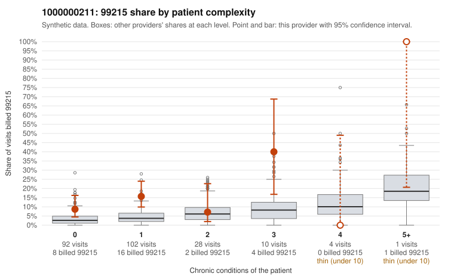

# 1000000211: 1000000211: 1 of 19 documented 99215 claims (5%) are documented below the billed level

**Leaning (advisory):** Pattern consistent with upcoding

## Why

1000000211 billed 99215 on 13.1% of 237 claims against an expected 3.6% given patient complexity (risk-adjusted score 3.04; plain z-score vs peers 1.30). 77% of this provider's 99215 claims were on patients with 0 or 1 chronic conditions. Records came back for 45 claims. Of 19 documented 99215 claims, 1 (5%) were documented below the billed level, against 43% for the comparison providers. Note checks on 45 returned notes (share showing each sign): problems 49%, late 16%, unsigned 0%, data 27%. No audit trail was received. 13 of 36 notes claiming moderate-or-higher data reviewed had no lab or test line on the claim. This pattern is consistent with upcoding. It is a reason to review the records, not a finding. Examples: C0106943: billed 99215, patient aged 45 with 1 chronic condition(s) (depression); documented MDM level moderate, minutes not recorded. C0106886: billed 99215, patient aged 45 with 1 chronic condition(s) (obesity). C0106893: billed 99215, patient aged 42 with 1 chronic condition(s) (osteoarthritis). C0106908: billed 99215, patient aged 41 with 1 chronic condition(s) (hyperlipidemia).

## Evidence chart

## Cited claims

`C0106943`, `C0106886`, `C0106893`, `C0106908`

## Suggested next steps

- Request the full charts for C0106943, C0106886, C0106893 and have a certified coder re-score each against the current E/M rules (medical decision making or total time).
- If the re-scoring confirms the pattern, review the random sample in the recovery packet's sampling plan before any overpayment estimate; do not extrapolate from a targeted sample.
- Look at the notes themselves: 49% address fewer problems than their level implies and 16% were signed late; request the audit trail for C0106943, C0106886, C0106893.

---
Citations checked: 4/4 valid. Synthetic data. The leaning is advisory; the flag comes from the statistical screen, and no clinical documentation is available beyond the sampled records-review facts shown in the packet.
