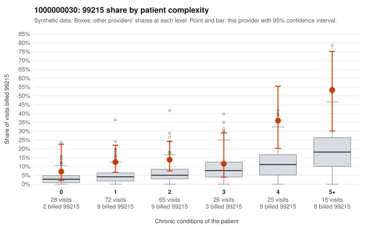

# 1000000030: 1000000030: too few returned records to judge

**Leaning (advisory):** Inconclusive

## Why

1000000030 billed 99215 on 17.3% of 231 claims against an expected 5.5% given patient complexity (risk-adjusted score 3.26; plain z-score vs peers 2.23). 28% of this provider's 99215 claims were on patients with 0 or 1 chronic conditions. Records came back for 24 claims. Of 11 documented 99215 claims, 1 (9%) were documented below the billed level, against 36% for the comparison providers. Note checks on 24 returned notes (share showing each sign): problems 12%, late 8%, unsigned 0%, data 0%. No audit trail was received. 0 of 16 notes claiming moderate-or-higher data reviewed had no lab or test line on the claim. The evidence does not support a call either way yet. Examples: C0010202: billed 99215, patient aged 53 with 4 chronic condition(s) (type 2 diabetes;hypertension;atrial fibrillation;osteoarthritis); documented MDM level moderate, minutes not recorded. C0010187: billed 99215, patient aged 69 with 1 chronic condition(s) (asthma). C0010243: billed 99215, patient aged 55 with 1 chronic condition(s) (depression).

## Evidence chart

## Cited claims

`C0010202`, `C0010187`, `C0010243`

## Suggested next steps

- 24 charts came back but do not settle it: request a targeted sample of 99215 charts, starting with C0010202, C0010187, C0010243.
- Re-check after the targeted charts arrive; do not call upcoding or a sicker panel on this evidence alone.

---
Citations checked: 3/3 valid. Synthetic data. The leaning is advisory; the flag comes from the statistical screen, and no clinical documentation is available beyond the sampled records-review facts shown in the packet.
