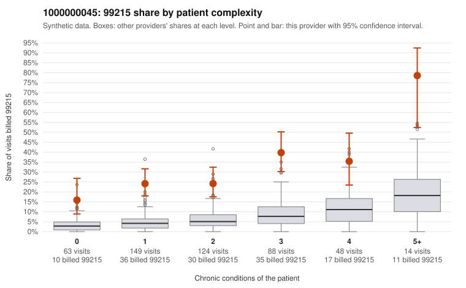

# 1000000045: 1000000045: 0 of 8 documented 99215 claims (0%) are documented below the billed level

**Leaning (advisory):** Pattern consistent with upcoding

## Why

1000000045 billed 99215 on 28.6% of 486 claims against an expected 5.2% given patient complexity (risk-adjusted score 10.07; plain z-score vs peers 4.51). 33% of this provider's 99215 claims were on patients with 0 or 1 chronic conditions. Records came back for 30 claims. Of 8 documented 99215 claims, 0 (0%) were documented below the billed level, against 36% for the comparison providers. Note checks on 30 returned notes (share showing each sign): problems 40%, late 17%, unsigned 0%, data 23%, bulk created 13%, paste heavy 17%. 8 of 21 notes claiming moderate-or-higher data reviewed had no lab or test line on the claim. This pattern is consistent with upcoding. It is a reason to review the records, not a finding. Examples: C0016437: billed 99214; documented MDM level low, minutes not recorded. C0016534: billed 99213; documented MDM level straightforward, minutes not recorded. C0016246: billed 99215, patient aged 37 with 1 chronic condition(s) (hypertension). C0016286: billed 99215, patient aged 28 with 1 chronic condition(s) (obesity). C0016289: billed 99215, patient aged 49 with 1 chronic condition(s) (depression).

## Evidence chart

## Cited claims

`C0016437`, `C0016534`, `C0016246`, `C0016286`, `C0016289`

## Suggested next steps

- Request the full charts for C0016437, C0016534, C0016246 and have a certified coder re-score each against the current E/M rules (medical decision making or total time).
- If the re-scoring confirms the pattern, review the random sample in the recovery packet's sampling plan before any overpayment estimate; do not extrapolate from a targeted sample.
- Look at the notes themselves: 40% address fewer problems than their level implies and 17% were signed late; request the audit trail for C0016437, C0016534, C0016246.

---
Citations checked: 5/5 valid. Synthetic data. The leaning is advisory; the flag comes from the statistical screen, and no clinical documentation is available beyond the sampled records-review facts shown in the packet.
