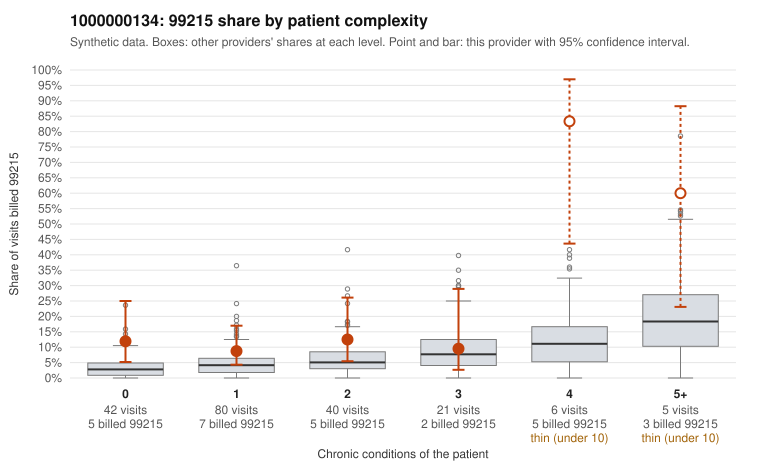

# 1000000134: 1000000134: too few returned records to judge

**Leaning (advisory):** Inconclusive

## Why

1000000134 billed 99215 on 13.9% of 194 claims against an expected 4.3% given patient complexity (risk-adjusted score 2.66; plain z-score vs peers 1.55). 44% of this provider's 99215 claims were on patients with 0 or 1 chronic conditions. Records came back for 27 claims. Of 6 documented 99215 claims, 0 (0%) were documented below the billed level, against 36% for the comparison providers. Note checks on 27 returned notes (share showing each sign): problems 33%, late 4%, unsigned 0%, data 0%. No audit trail was received. 1 of 19 notes claiming moderate-or-higher data reviewed had no lab or test line on the claim. The evidence does not support a call either way yet. Examples: C0055304: billed 99215, patient aged 37 with 1 chronic condition(s) (type 2 diabetes). C0055342: billed 99215, patient aged 29 with 1 chronic condition(s) (heart failure).

## Evidence chart

## Cited claims

`C0055304`, `C0055342`

## Suggested next steps

- 27 charts came back but do not settle it: request a targeted sample of 99215 charts, starting with C0055304, C0055342.
- Re-check after the targeted charts arrive; do not call upcoding or a sicker panel on this evidence alone.

---
Citations checked: 2/2 valid. Synthetic data. The leaning is advisory; the flag comes from the statistical screen, and no clinical documentation is available beyond the sampled records-review facts shown in the packet.
