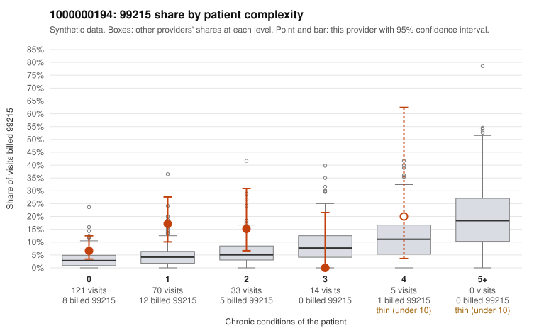

# 1000000194: 1000000194: 6 of 13 documented 99214 and 99215 claims (46%) are documented below the billed level

**Leaning (advisory):** Pattern consistent with upcoding

## Why

1000000194 billed 99215 on 10.7% of 243 claims against an expected 3.4% given patient complexity (risk-adjusted score 2.56; plain z-score vs peers 0.90). 77% of this provider's 99215 claims were on patients with 0 or 1 chronic conditions. Records came back for 30 claims. Of 4 documented 99215 claims, 2 (50%) were documented below the billed level, against 36% for the comparison providers. Note checks on 30 returned notes (share showing each sign): problems 23%, late 7%, unsigned 0%, data 3%. No audit trail was received. 1 of 8 notes claiming moderate-or-higher data reviewed had no lab or test line on the claim. This pattern is consistent with upcoding. It is a reason to review the records, not a finding. Examples: C0083808: billed 99215, patient aged 52 with 1 chronic condition(s) (asthma); documented MDM level moderate, 31 minutes. C0084026: billed 99215, patient aged 18 with 0 chronic condition(s); documented MDM level moderate, 39 minutes. C0083817: billed 99215, patient aged 20 with 0 chronic condition(s). C0083830: billed 99215, patient aged 63 with 1 chronic condition(s) (chronic kidney disease).

## Evidence chart

## Cited claims

`C0083808`, `C0084026`, `C0083817`, `C0083830`

## Suggested next steps

- Request the full charts for C0083808, C0084026, C0083817 and have a certified coder re-score each against the current E/M rules (medical decision making or total time).
- If the re-scoring confirms the pattern, review the random sample in the recovery packet's sampling plan before any overpayment estimate; do not extrapolate from a targeted sample.
- Look at the notes themselves: 23% address fewer problems than their level implies and 7% were signed late; request the audit trail for C0083808, C0084026, C0083817.

---
Citations checked: 4/4 valid. Synthetic data. The leaning is advisory; the flag comes from the statistical screen, and no clinical documentation is available beyond the sampled records-review facts shown in the packet.
