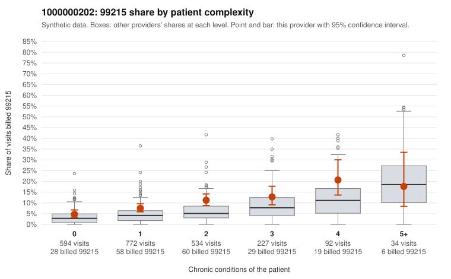

# 1000000202: Provider 1000000202 bills 99215 well above expectation, often on low-complexity patients, yet its small sample of returned charts supports the billed levels, while note-quality signals cast doubt on those charts.

**Leaning (advisory):** Inconclusive

## Why

1000000202 billed 99215 on 8.9% of 2,253 claims against an expected 4.2% given patient complexity (risk-adjusted score 4.61; plain z-score vs peers 0.53). 43% of this provider's 99215 claims were on patients with 0 or 1 chronic conditions. Records came back for 44 claims. Of 15 documented 99215 claims, 0 (0%) were documented below the billed level, against 36% for the comparison providers. Note checks on 44 returned notes (share showing each sign): problems 30%, late 18%, unsigned 0%, data 20%. No audit trail was received. 11 of 32 notes claiming moderate-or-higher data reviewed had no lab or test line on the claim. The billing pattern leans toward concern: the excess 99215 share appears in nearly every complexity stratum, and a large share of 99215s fall on patients with 0–1 chronic conditions, with sampled diagnoses such as rash, URI or a follow-up code alone (e.g., C0090685, C0091953, C0090334). Against that, none of the documented 99215 claims was documented below the billed level, compared with a much higher all-provider rate, and examples such as C0090213 and C0091223 show high MDM with time recorded, which fits a legitimately complex panel. That documentation is thin, though: only a small fraction of claims have charts. The note signals also suggest the charts may not reflect the visits, including frequent duplicate or problem flags, repeated times, and notes claiming moderate-or-higher data reviewed on claims with no lab or test line. This is weak evidence of cloned or inflated notes, not proof, and no audit trail was received to test it. A reviewer should first request charts and audit trails specifically for the sampled low-complexity 99215 claims, and check whether those notes are templated or duplicated across patients. Examples: C0090424: billed 99214; documented MDM level low, minutes not recorded. C0090002: billed 99215, patient aged 45 with 0 chronic condition(s). C0090146: billed 99215, patient aged 52 with 0 chronic condition(s).

## Evidence chart

## Cited claims

`C0090424`, `C0090002`, `C0090146`

## Suggested next steps

- 44 charts came back but do not settle it: request a targeted sample of 99215 charts, starting with C0090424, C0090002, C0090146.
- Re-check after the targeted charts arrive; do not call upcoding or a sicker panel on this evidence alone.

---
Citations checked: 3/3 valid. Synthetic data. The leaning is advisory; the flag comes from the statistical screen, and no clinical documentation is available beyond the sampled records-review facts shown in the packet.
