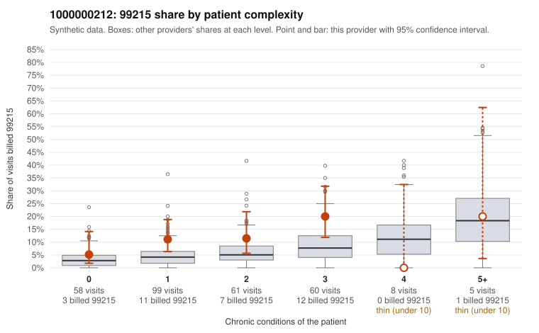

# 1000000212: 1000000212: documented 99215 claims mostly support the level billed (0% below)

**Leaning (advisory):** Pattern consistent with a high-acuity panel

## Why

1000000212 billed 99215 on 11.7% of 291 claims against an expected 4.5% given patient complexity (risk-adjusted score 2.35; plain z-score vs peers 1.09). 41% of this provider's 99215 claims were on patients with 0 or 1 chronic conditions. Records came back for 30 claims. Of 7 documented 99215 claims, 0 (0%) were documented below the billed level, against 36% for the comparison providers. Note checks on 30 returned notes (share showing each sign): problems 33%, late 3%, unsigned 0%, data 0%. No audit trail was received. 2 of 23 notes claiming moderate-or-higher data reviewed had no lab or test line on the claim. This pattern is consistent with a high-acuity panel. The sampled documentation supports the billed level. Examples: C0096281: billed 99215; documented MDM level high, 44 minutes. C0096364: billed 99215; documented MDM level high, minutes not recorded. C0096404: billed 99215, patient aged 38 with 0 chronic condition(s); documented MDM level high, 47 minutes. C0096305: billed 99215, patient aged 69 with 5 chronic condition(s) (hypothyroidism;type 2 diabetes;hyperlipidemia;COPD;asthma).

## Evidence chart

## Cited claims

`C0096281`, `C0096364`, `C0096404`, `C0096305`

## Suggested next steps

- Do not pursue recovery on this evidence: 30 charts came back and they support the level billed (0 of 7 documented 99215 claims below the billed level).
- Revisit if the 99215 share keeps rising against peers or a larger sample shows unsupported claims.

---
Citations checked: 4/4 valid. Synthetic data. The leaning is advisory; the flag comes from the statistical screen, and no clinical documentation is available beyond the sampled records-review facts shown in the packet.
