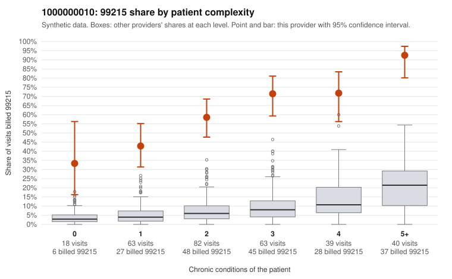

# 1000000010: 1000000010: too few returned records to judge

**Leaning (advisory):** Inconclusive

## Why

1000000010 billed 99215 on 62.6% of 305 claims against an expected 7.6% given patient complexity (risk-adjusted score 14.11; plain z-score vs peers 8.09). 17% of this provider's 99215 claims were on patients with 0 or 1 chronic conditions. Records came back for 30 claims. Of 23 documented 99215 claims, 2 (9%) were documented below the billed level, against 30% for the comparison providers. Note checks on 30 returned notes (share showing each sign): problems 13%, late 0%, unsigned 0%, data 13%. No audit trail was received. 4 of 26 notes claiming moderate-or-higher data reviewed had no lab or test line on the claim. The evidence does not support a call either way yet. Examples: C0003522: billed 99215; documented MDM level moderate, minutes not recorded. C0003681: billed 99215; documented MDM level moderate, minutes not recorded. C0003482: billed 99215, patient aged 39 with 0 chronic condition(s). C0003484: billed 99215, patient aged 35 with 1 chronic condition(s) (depression).

## Evidence chart

## Cited claims

`C0003522`, `C0003681`, `C0003482`, `C0003484`

## Suggested next steps

- 30 charts came back but do not settle it: request a targeted sample of 99215 charts, starting with C0003522, C0003681, C0003482.
- Re-check after the targeted charts arrive; do not call upcoding or a sicker panel on this evidence alone.

---
Citations checked: 4/4 valid. Synthetic data. The leaning is advisory; the flag comes from the statistical screen, and no clinical documentation is available beyond the sampled records-review facts shown in the packet.
