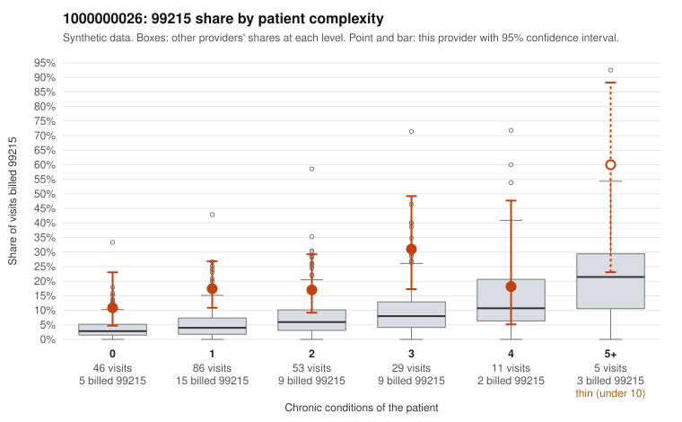

# 1000000026: 1000000026: too few returned records to judge

**Leaning (advisory):** Inconclusive

## Why

1000000026 billed 99215 on 18.7% of 230 claims against an expected 5.0% given patient complexity (risk-adjusted score 3.57; plain z-score vs peers 1.65). 47% of this provider's 99215 claims were on patients with 0 or 1 chronic conditions. Records came back for 30 claims. Of 9 documented 99215 claims, 0 (0%) were documented below the billed level, against 30% for the comparison providers. Note checks on 30 returned notes (share showing each sign): problems 17%, late 7%, unsigned 0%, data 7%. No audit trail was received. 4 of 19 notes claiming moderate-or-higher data reviewed had no lab or test line on the claim. The evidence does not support a call either way yet. Examples: C0010150: billed 99215, patient aged 36 with 1 chronic condition(s) (hyperlipidemia). C0010153: billed 99215, patient aged 40 with 1 chronic condition(s) (hyperlipidemia).

## Evidence chart

## Cited claims

`C0010150`, `C0010153`

## Suggested next steps

- 30 charts came back but do not settle it: request a targeted sample of 99215 charts, starting with C0010150, C0010153.
- Re-check after the targeted charts arrive; do not call upcoding or a sicker panel on this evidence alone.

---
Citations checked: 2/2 valid. Synthetic data. The leaning is advisory; the flag comes from the statistical screen, and no clinical documentation is available beyond the sampled records-review facts shown in the packet.
