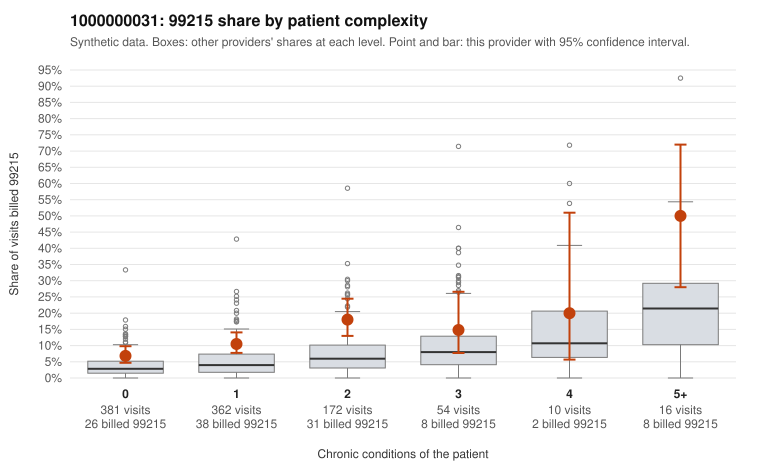

# 1000000031: 1000000031: too few returned records to judge

**Leaning (advisory):** Inconclusive

## Why

1000000031 billed 99215 on 11.4% of 995 claims against an expected 4.2% given patient complexity (risk-adjusted score 4.28; plain z-score vs peers 0.57). 57% of this provider's 99215 claims were on patients with 0 or 1 chronic conditions. Records came back for 24 claims. Of 2 documented 99215 claims, 1 (50%) were documented below the billed level, against 30% for the comparison providers. Note checks on 24 returned notes (share showing each sign): problems 29%, late 0%, unsigned 0%, data 0%. No audit trail was received. 0 of 15 notes claiming moderate-or-higher data reviewed had no lab or test line on the claim. The evidence does not support a call either way yet. Examples: C0015856: billed 99215, patient aged 73 with 5 chronic condition(s) (type 2 diabetes;hypertension;heart failure;asthma;osteoarthritis); documented MDM level moderate, 20 minutes. C0014998: billed 99215, patient aged 36 with 1 chronic condition(s) (hypertension). C0015001: billed 99215, patient aged 55 with 0 chronic condition(s).

## Evidence chart

## Cited claims

`C0015856`, `C0014998`, `C0015001`

## Suggested next steps

- 24 charts came back but do not settle it: request a targeted sample of 99215 charts, starting with C0015856, C0014998, C0015001.
- Re-check after the targeted charts arrive; do not call upcoding or a sicker panel on this evidence alone.

---
Citations checked: 3/3 valid. Synthetic data. The leaning is advisory; the flag comes from the statistical screen, and no clinical documentation is available beyond the sampled records-review facts shown in the packet.
