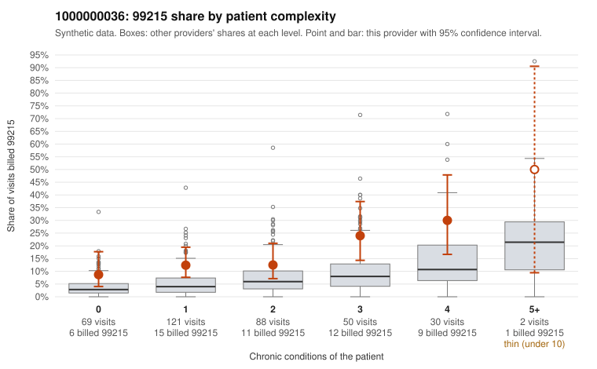

# 1000000036: 1000000036: too few returned records to judge

**Leaning (advisory):** Inconclusive

## Why

1000000036 billed 99215 on 15.0% of 360 claims against an expected 5.1% given patient complexity (risk-adjusted score 3.20; plain z-score vs peers 1.11). 39% of this provider's 99215 claims were on patients with 0 or 1 chronic conditions. Records came back for 29 claims. Of 6 documented 99215 claims, 3 (50%) were documented below the billed level, against 30% for the comparison providers. Note checks on 29 returned notes (share showing each sign): problems 28%, late 7%, unsigned 0%, data 7%. No audit trail was received. 2 of 20 notes claiming moderate-or-higher data reviewed had no lab or test line on the claim. The evidence does not support a call either way yet. Examples: C0018113: billed 99215, patient aged 57 with 1 chronic condition(s) (obesity); documented MDM level moderate, minutes not recorded. C0018153: billed 99215; documented MDM level moderate, 35 minutes. C0018080: billed 99215, patient aged 46 with 0 chronic condition(s). C0018087: billed 99215, patient aged 33 with 1 chronic condition(s) (osteoarthritis).

## Evidence chart

## Cited claims

`C0018113`, `C0018153`, `C0018080`, `C0018087`

## Suggested next steps

- 29 charts came back but do not settle it: request a targeted sample of 99215 charts, starting with C0018113, C0018153, C0018080.
- Re-check after the targeted charts arrive; do not call upcoding or a sicker panel on this evidence alone.

---
Citations checked: 4/4 valid. Synthetic data. The leaning is advisory; the flag comes from the statistical screen, and no clinical documentation is available beyond the sampled records-review facts shown in the packet.
