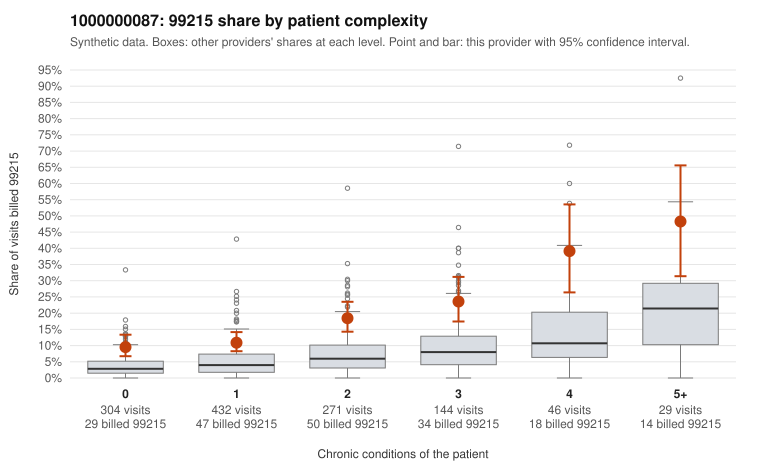

# 1000000087: 1000000087: too few returned records to judge

**Leaning (advisory):** Inconclusive

## Why

1000000087 billed 99215 on 15.7% of 1,226 claims against an expected 4.9% given patient complexity (risk-adjusted score 6.67; plain z-score vs peers 1.20). 40% of this provider's 99215 claims were on patients with 0 or 1 chronic conditions. Records came back for 30 claims. Of 7 documented 99215 claims, 2 (29%) were documented below the billed level, against 30% for the comparison providers. Note checks on 30 returned notes (share showing each sign): problems 27%, late 7%, unsigned 0%, data 17%. No audit trail was received. 5 of 22 notes claiming moderate-or-higher data reviewed had no lab or test line on the claim. The evidence does not support a call either way yet. Examples: C0037637: billed 99215; documented MDM level moderate, 30 minutes. C0038214: billed 99215, patient aged 44 with 1 chronic condition(s) (obesity); documented MDM level moderate, 34 minutes. C0037052: billed 99215, patient aged 57 with 0 chronic condition(s). C0037284: billed 99215, patient aged 52 with 1 chronic condition(s) (hyperlipidemia).

## Evidence chart

## Cited claims

`C0037637`, `C0038214`, `C0037052`, `C0037284`

## Suggested next steps

- 30 charts came back but do not settle it: request a targeted sample of 99215 charts, starting with C0037637, C0038214, C0037052.
- Re-check after the targeted charts arrive; do not call upcoding or a sicker panel on this evidence alone.

---
Citations checked: 4/4 valid. Synthetic data. The leaning is advisory; the flag comes from the statistical screen, and no clinical documentation is available beyond the sampled records-review facts shown in the packet.
