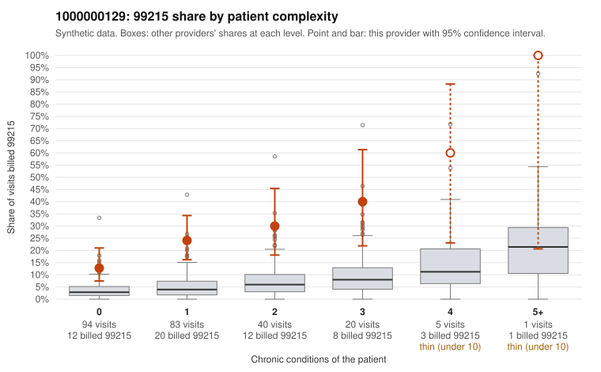

# 1000000129: 1000000129: 6 of 8 documented 99215 claims (75%) are documented below the billed level

**Leaning (advisory):** Pattern consistent with upcoding

## Why

1000000129 billed 99215 on 23.0% of 243 claims against an expected 4.2% given patient complexity (risk-adjusted score 5.60; plain z-score vs peers 2.29). 57% of this provider's 99215 claims were on patients with 0 or 1 chronic conditions. Records came back for 30 claims. Of 8 documented 99215 claims, 6 (75%) were documented below the billed level, against 30% for the comparison providers. Note checks on 30 returned notes (share showing each sign): problems 30%, late 0%, unsigned 0%, data 0%. No audit trail was received. 2 of 17 notes claiming moderate-or-higher data reviewed had no lab or test line on the claim. This pattern is consistent with upcoding. It is a reason to review the records, not a finding. Examples: C0064697: billed 99215, patient aged 27 with 0 chronic condition(s); documented MDM level moderate, 39 minutes. C0064715: billed 99215, patient aged 30 with 0 chronic condition(s); documented MDM level moderate, 33 minutes. C0064809: billed 99215; documented MDM level moderate, minutes not recorded. C0064698: billed 99215, patient aged 56 with 0 chronic condition(s). C0064703: billed 99215, patient aged 36 with 1 chronic condition(s) (type 2 diabetes).

## Evidence chart

## Cited claims

`C0064697`, `C0064715`, `C0064809`, `C0064698`, `C0064703`

## Suggested next steps

- Request the full charts for C0064697, C0064715, C0064809 and have a certified coder re-score each against the current E/M rules (medical decision making or total time).
- If the re-scoring confirms the pattern, review the random sample in the recovery packet's sampling plan before any overpayment estimate; do not extrapolate from a targeted sample.
- Look at the notes themselves: 30% address fewer problems than their level implies and 0% were signed late; request the audit trail for C0064697, C0064715, C0064809.

---
Citations checked: 5/5 valid. Synthetic data. The leaning is advisory; the flag comes from the statistical screen, and no clinical documentation is available beyond the sampled records-review facts shown in the packet.
