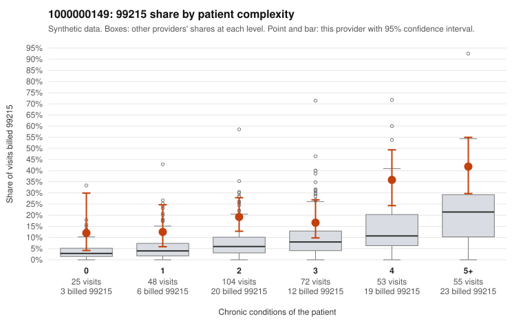

# 1000000149: 1000000149: documented 99215 claims mostly support the level billed (10% below)

**Leaning (advisory):** Pattern consistent with a high-acuity panel

## Why

1000000149 billed 99215 on 23.2% of 357 claims against an expected 8.1% given patient complexity (risk-adjusted score 4.02; plain z-score vs peers 2.32). 11% of this provider's 99215 claims were on patients with 0 or 1 chronic conditions. Records came back for 45 claims. Of 20 documented 99215 claims, 2 (10%) were documented below the billed level, against 30% for the comparison providers. Note checks on 45 returned notes (share showing each sign): problems 13%, late 11%, unsigned 0%, data 7%. No audit trail was received. 5 of 36 notes claiming moderate-or-higher data reviewed had no lab or test line on the claim. This pattern is consistent with a high-acuity panel. The sampled documentation supports the billed level. Examples: C0072376: billed 99215; documented MDM level high, 49 minutes. C0072533: billed 99215; documented MDM level high, 48 minutes. C0072536: billed 99215; documented MDM level high, minutes not recorded. C0072427: billed 99215, patient aged 90 with 4 chronic condition(s) (obesity;hyperlipidemia;depression;asthma). C0072477: billed 99215, patient aged 57 with 5 chronic condition(s) (type 2 diabetes;depression;atrial fibrillation;COPD;asthma).

## Evidence chart

## Cited claims

`C0072376`, `C0072533`, `C0072536`, `C0072427`, `C0072477`

## Suggested next steps

- Do not pursue recovery on this evidence: 45 charts came back and they support the level billed (2 of 20 documented 99215 claims below the billed level).
- Revisit if the 99215 share keeps rising against peers or a larger sample shows unsupported claims.

---
Citations checked: 5/5 valid. Synthetic data. The leaning is advisory; the flag comes from the statistical screen, and no clinical documentation is available beyond the sampled records-review facts shown in the packet.
