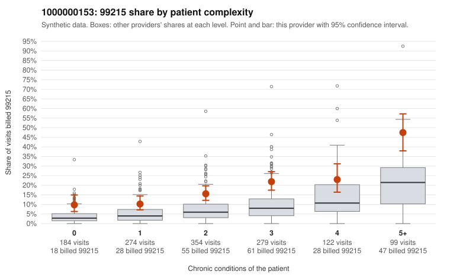

# 1000000153: 1000000153: documented 99215 claims mostly support the level billed (14% below)

**Leaning (advisory):** Pattern consistent with a high-acuity panel

## Why

1000000153 billed 99215 on 18.1% of 1,312 claims against an expected 6.5% given patient complexity (risk-adjusted score 6.51; plain z-score vs peers 1.56). 19% of this provider's 99215 claims were on patients with 0 or 1 chronic conditions. Records came back for 30 claims. Of 7 documented 99215 claims, 1 (14%) were documented below the billed level, against 30% for the comparison providers. Note checks on 30 returned notes (share showing each sign): problems 17%, late 3%, unsigned 0%, data 3%. No audit trail was received. 1 of 21 notes claiming moderate-or-higher data reviewed had no lab or test line on the claim. This pattern is consistent with a high-acuity panel. The sampled documentation supports the billed level. Examples: C0073612: billed 99215; documented MDM level high, 33 minutes. C0073637: billed 99215; documented MDM level high, minutes not recorded. C0073787: billed 99215; documented MDM level high, minutes not recorded. C0073537: billed 99215, patient aged 64 with 4 chronic condition(s) (obesity;hyperlipidemia;hypertension;osteoarthritis). C0073717: billed 99215, patient aged 85 with 4 chronic condition(s) (hyperlipidemia;depression;atrial fibrillation;COPD).

## Evidence chart

## Cited claims

`C0073612`, `C0073637`, `C0073787`, `C0073537`, `C0073717`

## Suggested next steps

- Do not pursue recovery on this evidence: 30 charts came back and they support the level billed (1 of 7 documented 99215 claims below the billed level).
- Revisit if the 99215 share keeps rising against peers or a larger sample shows unsupported claims.

---
Citations checked: 5/5 valid. Synthetic data. The leaning is advisory; the flag comes from the statistical screen, and no clinical documentation is available beyond the sampled records-review facts shown in the packet.
