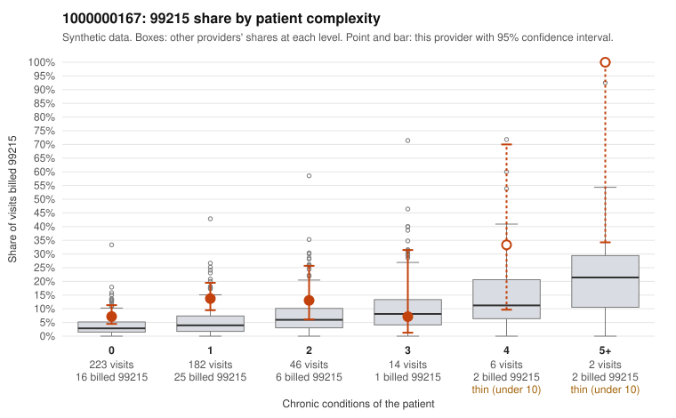

# 1000000167: 1000000167: documented 99215 claims mostly support the level billed (21% below)

**Leaning (advisory):** Pattern consistent with a high-acuity panel

## Why

1000000167 billed 99215 on 11.0% of 473 claims against an expected 3.7% given patient complexity (risk-adjusted score 3.11; plain z-score vs peers 0.52). 79% of this provider's 99215 claims were on patients with 0 or 1 chronic conditions. Records came back for 45 claims. Of 19 documented 99215 claims, 4 (21%) were documented below the billed level, against 30% for the comparison providers. Note checks on 45 returned notes (share showing each sign): problems 38%, late 7%, unsigned 0%, data 7%, bulk created 0%, paste heavy 2%. 3 of 30 notes claiming moderate-or-higher data reviewed had no lab or test line on the claim. This pattern is consistent with a high-acuity panel. The sampled documentation supports the billed level. Examples: C0079498: billed 99215; documented MDM level high, 49 minutes. C0079571: billed 99215; documented MDM level high, minutes not recorded. C0079947: billed 99215; documented MDM level high, 45 minutes. C0079502: billed 99215, patient aged 71 with 4 chronic condition(s) (obesity;hypertension;atrial fibrillation;osteoarthritis). C0079649: billed 99215, patient aged 86 with 5 chronic condition(s) (obesity;depression;atrial fibrillation;asthma;chronic kidney disease).

## Evidence chart

## Cited claims

`C0079498`, `C0079571`, `C0079947`, `C0079502`, `C0079649`

## Suggested next steps

- Do not pursue recovery on this evidence: 45 charts came back and they support the level billed (4 of 19 documented 99215 claims below the billed level).
- Revisit if the 99215 share keeps rising against peers or a larger sample shows unsupported claims.

---
Citations checked: 5/5 valid. Synthetic data. The leaning is advisory; the flag comes from the statistical screen, and no clinical documentation is available beyond the sampled records-review facts shown in the packet.
